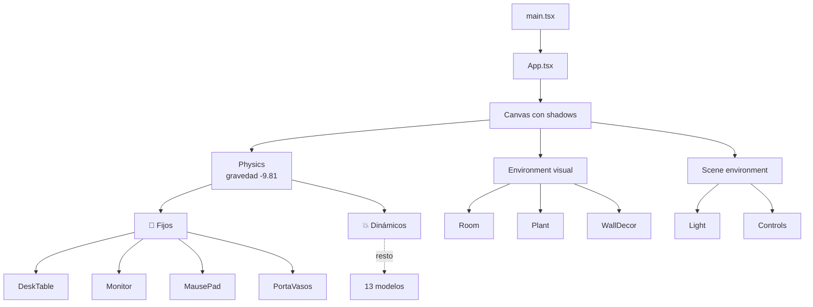

# Estructura de carpetas

> Inicio > 01 — Arquitectura > Estructura de carpetas

Mapa completo del proyecto, archivo por archivo, con la función de cada uno.

## Árbol completo

```
portafolio/
│
├── public/                                # Assets estáticos servidos tal cual
│   └── 3d-models/                         # 17 modelos .glb (uno por componente 3D)
│       ├── band.glb
│       ├── clock.glb
│       ├── desk-table.glb
│       ├── gitHubLogo.glb
│       ├── headPhones.glb
│       ├── keyboard.glb
│       ├── lamp.glb
│       ├── lapiz.glb
│       ├── logoLinkedin.glb
│       ├── mause.glb
│       ├── mausePad.glb
│       ├── monitor.glb
│       ├── porta-lapiceros.glb
│       ├── portaVasos.glb
│       ├── roboticHand.glb
│       ├── taza.glb
│       └── vehicle.glb                    # coche conducible (ruedas separadas)
│
├── src/                                   # Código fuente
│   ├── components/
│   │   ├── 3d-models/                     # 17 modelos 3D, todos con RigidBody
│   │   │   ├── Band.tsx                   #   dinámico
│   │   │   ├── Clock.tsx                  #   dinámico
│   │   │   ├── DeskTable.tsx              #   FIJO
│   │   │   ├── GitHubLogo.tsx             #   dinámico
│   │   │   ├── HeadPhones.tsx             #   dinámico
│   │   │   ├── KeyBoard.tsx               #   dinámico
│   │   │   ├── Lamp.tsx                   #   dinámico
│   │   │   ├── Lapiz.tsx                  #   dinámico, reutilizable (paleta)
│   │   │   ├── LinkedinLogo.tsx           #   dinámico
│   │   │   ├── Mause.tsx                  #   dinámico
│   │   │   ├── MausePad.tsx               #   FIJO
│   │   │   ├── Monitor.tsx                #   FIJO
│   │   │   ├── PortaLapiceros.tsx         #   dinámico
│   │   │   ├── PortaVasos.tsx             #   FIJO
│   │   │   ├── RoboticHand.tsx            #   dinámico
│   │   │   ├── Taza.tsx                   #   dinámico
│   │   │
│   │   ├── player/                        # Personaje controlable
│   │   │   ├── DrivableVehicle.tsx        # Coche conducible (el que se monta)
│   │   │   ├── keyboardMap.ts             # Acciones y teclas
│   │   │   └── Player.tsx                 # Gato animado (sin montar)
│   │   │
│   │   ├── scene-environment/             # Luz, controles, loader
│   │   │   ├── camera.ts                  # Posición y objetivo de la cámara fija
│   │   │   ├── Controls.tsx               # Cámara fija (sin OrbitControls)
│   │   │   ├── ControlsHelp.tsx           # Panel de instrucciones de teclado
│   │   │   ├── Light.tsx                  # ambient + 2 directionales con sombras
│   │   │   ├── Loader.tsx                 # Pantalla de carga con useProgress
│   │   │   └── StatsOverlay.tsx           # Overlay FPS (sólo en desarrollo)
│   │   │
│   │   ├── environment/                   # 🆕 Environment visual (interior)
│   │   │   ├── Floor.tsx                  # Suelo físico (dentro de <Physics>)
│   │   │   ├── Room.tsx                   # Paredes + alfombra (fuera de <Physics>)
│   │   │   ├── Plant.tsx                  # Planta decorativa
│   │   │   └── WallDecor.tsx              # Cuadro en pared trasera
│   │   │
│   │   └── physics/                       # 🆕 Sistema de físicas con Rapier
│   │       ├── AutoGLTF.tsx               # Renderiza todas las mallas de un .glb
│   │       └── RigidObject.tsx            # HOC: RigidBody + sonido de impacto
│   │
│   ├── audio/                             # Sonido sintetizado (Web Audio)
│   │   └── sound.ts                       # playImpact, silencio
│   │
│   ├── helpers/                           # Utilidades compartidas
│   │   └── paleta-colores.ts              # Paleta de colores tipada
│   │
│   ├── hooks/                             # Hooks personalizados
│   │   └── useFloorImpact.ts              # Golpes contra el suelo → sonido / callback
│   │
│   ├── App.tsx                            # Raíz: integra Physics + Environment + modelos
│   ├── index.css                          # Estilos globales
│   └── main.tsx                           # createRoot + <StrictMode>
│
├── docs/                                  # 📚 Documentación
│   ├── README.md
│   └── (…)
│
├── eslint.config.js
├── vite.config.ts
├── tsconfig.json / .app.json / .node.json
├── index.html
├── package.json
├── package-lock.json
├── .gitignore
└── README.md
```

## Conteo de archivos

| Tipo | Cantidad |
|---|---|
| Modelos 3D (`src/components/3d-models/*.tsx`) | 17 (4 fijos + 13 dinámicos) |
| Componentes de escena (`src/components/scene-environment/`) | 5 |
| Componentes de environment (`src/components/environment/`) | 3 |
| Componentes de físicas (`src/components/physics/`) | 2 |
| Hooks (`src/hooks/`) | 1 |
| Helpers (`src/helpers/`) | 2 |
| Modelos `.glb` (`public/3d-models/`) | 17 |
| Archivos de configuración | 7 |

## Diagrama de capas del runtime



## Documentos relacionados

- [Visión general](./vision-general.md)
- [Stack tecnológico](./stack-tecnologico.md)
- [Sistema de escena](../04-escena-3d/sistema-de-escena.md)
- [Sistema de físicas](../04-escena-3d/sistema-de-fisicas.md)