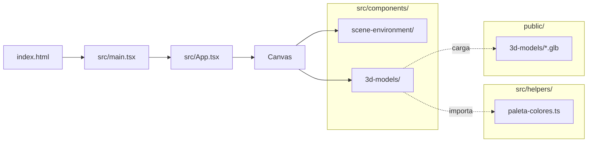

# Estructura de carpetas

> Inicio > 01 — Arquitectura > Estructura de carpetas

Mapa completo del proyecto, archivo por archivo, con la función de cada uno.

## Árbol completo

```
portafolio/
│
├── public/                          # Assets estáticos servidos tal cual
│   └── 3d-models/                   # 17 modelos .glb (uno por componente 3D)
│       ├── band.glb
│       ├── clock.glb
│       ├── desk-table.glb
│       ├── gitHubLogo.glb
│       ├── headPhones.glb
│       ├── keyboard.glb
│       ├── lamp.glb
│       ├── lapiz.glb
│       ├── logoLinkedin.glb
│       ├── mause.glb
│       ├── mausePad.glb
│       ├── monitor.glb
│       ├── porta-lapiceros.glb
│       ├── portaVasos.glb
│       ├── roboticHand.glb
│       ├── taza.glb
│       └── vehicle.glb
│
├── src/                             # Código fuente
│   ├── components/                  # Componentes React
│   │   ├── 3d-models/               # Componentes que renderizan modelos 3D
│   │   │   ├── Band.tsx
│   │   │   ├── Clock.tsx
│   │   │   ├── DeskTable.tsx
│   │   │   ├── GitHubLogo.tsx
│   │   │   ├── HeadPhones.tsx
│   │   │   ├── KeyBoard.tsx
│   │   │   ├── Lamp.tsx
│   │   │   ├── Lapiz.tsx
│   │   │   ├── LinkedinLogo.tsx
│   │   │   ├── Mause.tsx
│   │   │   ├── MausePad.tsx
│   │   │   ├── Monitor.tsx
│   │   │   ├── PortaLapiceros.tsx
│   │   │   ├── PortaVasos.tsx
│   │   │   ├── RoboticHand.tsx
│   │   │   ├── Taza.tsx
│   │   │   └── Vehicle.tsx
│   │   │
│   │   └── scene-environment/       # Componentes del entorno de la escena 3D
│   │       ├── CamaraController.tsx # Posiciona la cámara inicial
│   │       ├── Controls.tsx         # OrbitControls (rotar/zoom con ratón)
│   │       └── Light.tsx            # Luz direccional + helper de debug
│   │
│   ├── helpers/                     # Utilidades compartidas
│   │   └── paleta-colores.ts        # Paleta de colores tipada (12 gamas × 5 tonos)
│   │
│   ├── hooks/                       # Hooks personalizados de React
│   │   └── (vacío)                 # Carpeta reservada, sin archivos
│   │
│   ├── App.tsx                      # Componente raíz: monta <Canvas> y todos los modelos
│   ├── index.css                    # Estilos globales (mínimos)
│   └── main.tsx                     # Punto de entrada: createRoot + <StrictMode>
│
├── docs/                            # 📚 Esta documentación
│   ├── README.md
│   └── (…)
│
├── eslint.config.js                 # Configuración de ESLint (formato flat)
├── vite.config.ts                   # Configuración de Vite (sólo el plugin de React)
├── tsconfig.json                    # Config base de TS (referencia a .app y .node)
├── tsconfig.app.json                # TS config para el código de src/
├── tsconfig.node.json               # TS config para vite.config.ts
├── index.html                       # HTML único con <div id="root">
├── package.json                     # Dependencias y scripts
├── package-lock.json                # Lockfile de npm
├── .gitignore                       # Exclusiones estándar de Vite + node_modules, dist
└── README.md                        # README genérico de plantilla Vite (no documenta el proyecto)
```

## Función de cada archivo de configuración

### `vite.config.ts`

```ts
import react from '@vitejs/plugin-react'
import { defineConfig } from 'vite'

export default defineConfig({
  plugins: [react()],
})
```

Configuración mínima. Sólo activa el plugin de React. No hay configuración de puerto, alias, build options, etc.

### `tsconfig.json` (raíz)

Archivo raíz que simplemente referencia a las dos configs especializadas:

```jsonc
{
  "files": [],
  "references": [
    { "path": "./tsconfig.app.json" },
    { "path": "./tsconfig.node.json" }
  ]
}
```

### `tsconfig.app.json`

Configuración para todo el código dentro de `src/`. Características clave:

- `target: "es2023"` — código moderno.
- `module: "esnext"` + `moduleResolution: "bundler"` — pensado para Vite.
- `jsx: "react-jsx"` — no hace falta `import React from 'react'`.
- `noEmit: true` — el código lo emite Vite, no tsc.
- `noUnusedLocals` y `noUnusedParameters` — fallará si dejas código muerto.

### `tsconfig.node.json`

Configuración para archivos del entorno Node (en este proyecto, sólo `vite.config.ts`).

### `eslint.config.js`

ESLint en formato **flat config** (ESLint 9+). Activa:

- Reglas recomendadas de JS (`@eslint/js`).
- Reglas recomendadas de TS (`typescript-eslint`).
- Reglas de hooks de React (`eslint-plugin-react-hooks`).
- Reglas de Fast Refresh (`eslint-plugin-react-refresh`).
- Globales de navegador (`globals.browser`).

Ignora la carpeta `dist/`.

## Conteo de archivos

| Tipo | Cantidad |
|---|---|
| Componentes 3D (`src/components/3d-models/*.tsx`) | 17 |
| Componentes de escena (`src/components/scene-environment/*.tsx`) | 3 |
| Helpers (`src/helpers/`) | 1 |
| Hooks (`src/hooks/`) | 0 (carpeta vacía) |
| Modelos `.glb` (`public/3d-models/`) | 17 |
| Archivos de configuración | 7 |

## Diagrama de responsabilidades



## Documentos relacionados

- [Visión general](./vision-general.md)
- [Stack tecnológico](./stack-tecnologico.md)
- [Cómo añadir un modelo 3D](../03-componentes/como-anadir-modelo-3d.md)