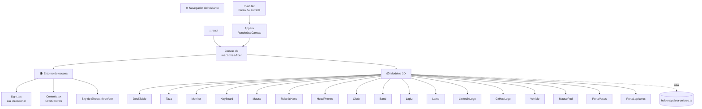
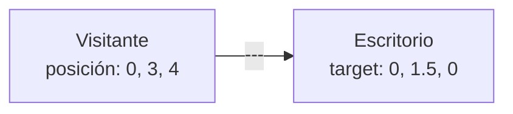

# Visión general del proyecto

> Inicio > 01 — Arquitectura > Visión general

## ¿Qué es?

Este proyecto es un **portafolio personal interactivo en 3D**. En lugar de una página web tradicional con texto, imágenes y secciones estáticas, renderiza un **escritorio virtual** completamente en 3D que el visitante puede explorar rotando la cámara con el ratón.

Sobre el escritorio se encuentran una serie de objetos 3D exportados en formato `.glb`:

- Objetos de oficina (escritorio, taza, monitor, teclado, ratón, alfombrilla, lámpara, reloj)
- Accesorios (auriculares, portalápices, lápices, banda elástica)
- Elementos decorativos/temáticos (mano robótica, vehículo)
- Iconos sociales (logo de LinkedIn, logo de GitHub)

## Objetivo

Servir como presentación visual del autor. Es la carta de presentación de un desarrollador/a que quiere mostrar:

- Dominio de **React + TypeScript**
- Conocimiento de **three.js** y renderizado 3D en el navegador
- Capacidad de integrar librerías modernas (`react-three-fiber`, `@react-three/drei`)
- Sensibilidad estética (la paleta de colores está cuidadosamente definida en `helpers/paleta-colores.ts`)

## Alcance

El proyecto se centra **exclusivamente en la escena 3D**. No incluye:

- ❌ Páginas HTML adicionales (sobre mí, proyectos, contacto).
- ❌ Backend, autenticación ni base de datos.
- ❌ Contenido dinámico cargado desde APIs externas.
- ❌ Animaciones complejas (los objetos son estáticos, sólo la cámara se mueve).

Es decir, es **una única pantalla** que muestra un escritorio 3D navegable.

## Vista de alto nivel de la arquitectura

## Cómo se "ve" el escritorio desde la cámara

La cámara está posicionada en `(0, 3, 4)` y orbita alrededor del punto `(0, 1.5, 0)` (definido como `target` en `OrbitControls`). Esto coloca al visitante ligeramente por encima del escritorio y mirando hacia abajo con un ángulo frontal-tres-cuartos.

El visitante puede:

- 🖱️ **Rotar** la cámara arrastrando con el ratón.
- 🔍 **Hacer zoom** con la rueda del ratón (esto está habilitado en `OrbitControls`).
- 🐾 **Mover el personaje** con el teclado y **empujar** los objetos del escritorio (físicas con Rapier).

## Tipos de componentes

El proyecto distingue dos tipos de componentes 3D:

1. **Componentes simples** (la mayoría): sólo posicionan un modelo en el espacio. Reciben `props: JSX.IntrinsicElements['group']` (position, rotation, scale).
2. **Componentes parametrizables**: admiten props customizadas para variar su aspecto. Hoy sólo `Lapiz.tsx` sigue este patrón, recibiendo `paleta` e `intensidad` para colorear dinámicamente el cuerpo del lápiz.

## Documentos relacionados

- [Stack tecnológico](./stack-tecnologico.md)
- [Estructura de carpetas](./estructura-carpetas.md)
- [Sistema de escena](../04-escena-3d/sistema-de-escena.md)
- [Sistema de colores](../05-estilos/sistema-de-colores.md)