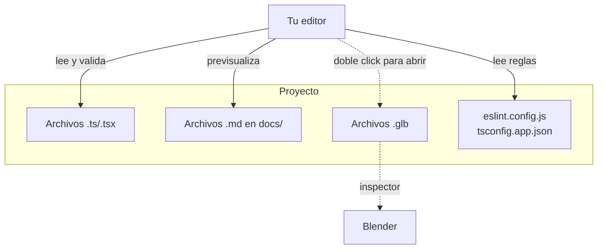

# Configuración de IDEs

> Inicio > 02 — Setup > Configuración de IDEs

Recomendaciones para configurar tu editor y aprovechar el proyecto al máximo.

## VSCode (recomendado)

Es el editor más extendido para este tipo de proyectos. Las siguientes extensiones son muy útiles.

### Extensiones recomendadas

| Extensión | ID | Por qué |
|---|---|---|
| **ESLint** | `dbaeumer.vscode-eslint` | Resalta errores y auto-aplica reglas del `eslint.config.js` mientras escribes. |
| **TypeScript + Webpack Problem Matchers** *(built-in)* | — | El language server de TS viene integrado en VSCode. |
| **Three.js Snippets** | `arzyu.three-snippets` | Snippets para three.js (`THREE.PerspectiveCamera`, `MeshBasicMaterial`, etc.). |
| **React Three Fiber Snippets** | `feirefana` *(buscar "r3f")* | Snippets para `<Canvas>`, `useGLTF`, `useFrame`. |
| **Markdown All in One** | `yzhang.markdown-all-in-one` | Mejor experiencia leyendo y editando esta documentación en `docs/`. |
| **Mermaid Preview** | `bierner.markdown-mermaid` | Previsualiza los diagramas Mermaid en archivos Markdown. |
| **Path Intellisense** | `christian-kohler.path-intellisense` | Autocompleta rutas como `'./components/3d-models/'`. |
| **Material Icon Theme** | `pkief.material-icon-theme` | Iconos reconocibles para `.tsx`, `.glb`, `.tsconfig.json`, etc. |

### Configuración recomendada (`settings.json`)

```jsonc
{
  // ESLint
  "eslint.enable": true,
  "eslint.validate": ["javascript", "typescript", "typescriptreact"],

  // Format on save con Prettier (opcional; no hay Prettier instalado todavía)
  // "editor.formatOnSave": true,
  // "editor.defaultFormatter": "esbenp.prettier-vscode",

  // TS
  "typescript.tsdk": "node_modules/typescript/lib",
  "typescript.enablePromptUseWorkspaceTsdk": true,

  // Archivos excluidos del explorador
  "files.exclude": {
    "**/node_modules": true,
    "**/dist": true,
    "**/.git": true
  },

  // Asociaciones para .glb (icono)
  "files.associations": {
    "*.glb": "default"
  }
}
```

### Tareas útiles (`tasks.json`)

Puedes crear un `.vscode/tasks.json` para correr los scripts npm desde la paleta de comandos:

```jsonc
{
  "version": "2.0.0",
  "tasks": [
    {
      "label": "Dev server",
      "type": "npm",
      "script": "dev",
      "problemMatcher": [],
      "presentation": { "reveal": "always" }
    },
    {
      "label": "Build",
      "type": "npm",
      "script": "build",
      "problemMatcher": ["$tsc"],
      "presentation": { "reveal": "always" }
    },
    {
      "label": "Lint",
      "type": "npm",
      "script": "lint",
      "problemMatcher": ["$eslint-stylish"],
      "presentation": { "reveal": "always" }
    }
  ]
}
```

## WebStorm / IntelliJ IDEA

- Tiene soporte **nativo** para TypeScript, React y ESLint (con el plugin correspondiente).
- Activa **ESLint** desde `Settings → Languages & Frameworks → JavaScript → Code Quality Tools → ESLint`.
- Activa **TypeScript** desde `Settings → Languages & Frameworks → TypeScript`.
- El plugin `.glb` no existe oficialmente, pero puedes configurar que los abra como **binario**.

## Sublime Text / Atom / Vim

- Cada uno tiene paquetes TypeScript y ESLint, pero el soporte es menos inmediato que en VSCode/WebStorm.
- Si tu editor soporta LSP, conecta [`typescript-language-server`](https://github.com/typescript-language-server/typescript-language-server) y [`eslint-lsp`](https://github.com/hrwolfsj/eslint-lsp).

## Configuración de tres.js

Si trabajas mucho con modelos 3D, instala **Blender** (gratuito) para:

- Inspeccionar los `.glb` en `public/3d-models/`.
- Reexportar modelos con diferentes niveles de detalle.
- Renombrar los nodos internos (`baseBorrador`, `cuerpoLapiz`, etc.) que el código TSX consume.

## Diagrama: tu editor y el proyecto



## Documentos relacionados

- [Instalación](./instalacion.md)
- [Scripts npm](./scripts-npm.md)
- [Estructura de carpetas](../01-arquitectura/estructura-carpetas.md)