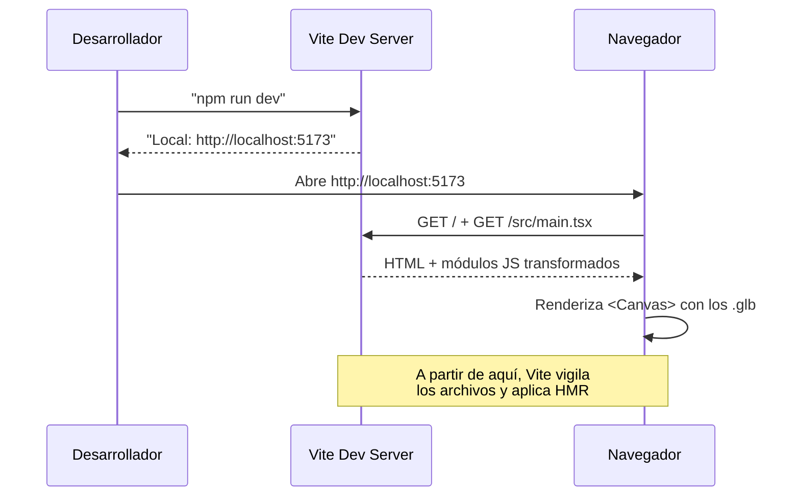

# Instalación

> Inicio > 02 — Setup > Instalación

Cómo preparar el entorno local para desarrollar el portafolio.

## Requisitos previos

| Herramienta | Versión mínima recomendada |
|---|---|
| **Node.js** | ≥ 20 (las dependencias usan APIs de Node 20+) |
| **npm** | ≥ 10 (incluido con Node 20) |
| **Git** | cualquiera reciente |

> 💡 Si tienes [nvm](https://github.com/nvm-sh/nvm) instalado puedes fijar la versión del proyecto con `nvm use`.

## 1. Clonar el repositorio

```bash
git clone <url-del-repo>
cd portafolio
```

## 2. Instalar dependencias

```bash
npm install
```

Esto instalará todas las dependencias listadas en `package.json` respetando `package-lock.json`. La instalación puede tardar 1-2 minutos la primera vez.

### ¿Qué se instala?

- **Producción:** React 19, three.js 0.186, @react-three/fiber, @react-three/drei, @react-three/rapier.
- **Desarrollo:** Vite 8, TypeScript 6, ESLint 10, typescript-eslint, plugin de React para ESLint.

Ver detalles completos en [Stack tecnológico](../01-arquitectura/stack-tecnologico.md).

## 3. Arrancar el servidor de desarrollo

```bash
npm run dev
```

Por defecto Vite abre en `http://localhost:5173`. Verás la escena del portafolio renderizada.



## 4. (Opcional) Compilar para producción

```bash
npm run build
```

Esto ejecuta `tsc -b && vite build`, que:

1. **Type-check** todo el código TypeScript (con `tsconfig.app.json`).
2. **Empaqueta** con Vite a la carpeta `dist/`.

Si la build falla por errores de tipos, **no** se generará la carpeta `dist/`.

## 5. (Opcional) Previsualizar la build

```bash
npm run preview
```

Levanta un servidor estático en `http://localhost:4173` que sirve la build de producción. Útil para verificar que todo funciona igual que en deploy.

## Troubleshooting

### `npm install` falla con errores de permisos

```bash
# No uses sudo. Solución:
sudo chown -R $USER:$GROUP ~/.npm
```

### `npm run dev` dice "port 5173 is already in use"

Vite elegirá automáticamente otro puerto (5174, 5175, …) y lo imprimirá en consola. Puedes forzarlo:

```bash
npm run dev -- --port 3000
```

### Los modelos 3D no cargan (pantalla negra)

1. Abre las DevTools del navegador (F12).
2. Ve a la pestaña **Network**.
3. Filtra por `.glb`. Verás que Vite los sirve desde `/3d-models/`.
4. Si algún `.glb` da 404, comprueba que el archivo está en `public/3d-models/`.
5. Si da CORS o error de MIME, asegúrate de que no moviste `public/` por error.

### Errores de TypeScript en el IDE

```bash
# Regenera los build infos
rm -rf node_modules/.tmp
npm run build
```

### Errores de ESLint

```bash
npm run lint
```

Te mostrará qué reglas se rompen. Recuerda que `noUnusedLocals` y `noUnusedParameters` están activos: cualquier variable o parámetro sin usar **falla el type-check**.

## Diagrama de flujo de un cambio

```mermaid
flowchart LR
    Edit[✏️ Editas un .tsx] --> HMR{HMR disponible?}
    HMR -- sí --> Reload[🔄 Vite reinyecta el módulo]
    HMR -- no --> Reload2[🔄 Recarga completa]
    Reload --> Browser[🌐 Navegador refleja el cambio]
    Reload2 --> Browser
    Edit -. alternativa .-> Build[📦 "npm run build"
    para verificar producción]
```

## Documentos relacionados

- [Scripts npm](./scripts-npm.md)
- [Configuración de IDEs](./configuracion-ides.md)
- [Estructura de carpetas](../01-arquitectura/estructura-carpetas.md)