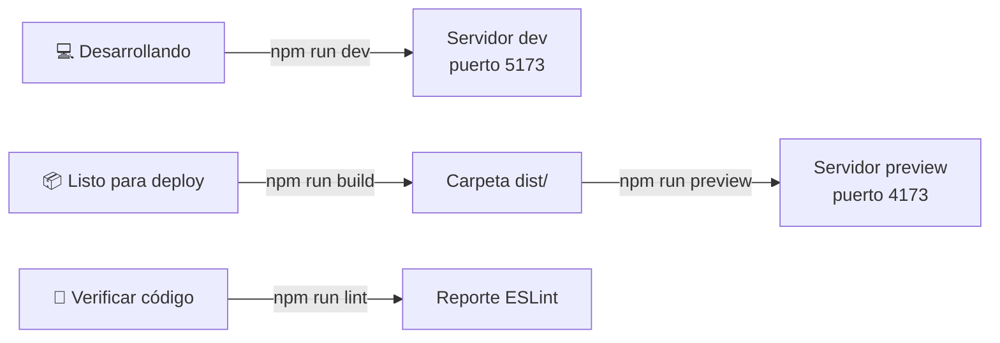

# Scripts npm

> Inicio > 02 — Setup > Scripts npm

Referencia rápida de todos los scripts definidos en `package.json`.

## Listado

```json
{
  "scripts": {
    "dev": "vite",
    "build": "tsc -b && vite build",
    "lint": "eslint .",
    "preview": "vite preview"
  }
}
```

## `npm run dev`

Arranca el **servidor de desarrollo** de Vite.

```bash
npm run dev
```

- **Comando subyacente:** `vite`
- **Uso:** mientras escribes código, quieres ver los cambios al instante.
- **Puerto por defecto:** `5173` (si está ocupado, Vite elige el siguiente libre).
- **Hot Module Replacement (HMR):** activo. Los cambios en componentes React se aplican sin recargar la página.

Útil para:

- Desarrollo activo.
- Probar cambios visuales rápidamente.
- Iterar sobre el posicionamiento de los modelos 3D.

## `npm run build`

Compila el proyecto para **producción**.

```bash
npm run build
```

- **Comando subyacente:** `tsc -b && vite build`
- **Pasos:**
  1. `tsc -b` — type-check de TypeScript con **build mode** (procesa `tsconfig.app.json` y `tsconfig.node.json`).
  2. `vite build` — bundle y minificación. Empaqueta en `dist/`.
- **Si la fase de types falla**, no se llega a ejecutar `vite build` y `dist/` no se actualiza.

Útil para:

- Antes de desplegar a producción.
- Verificar que el proyecto compila sin errores de tipos.
- Obtener estadísticas de tamaño del bundle.

Output esperado:

```
vite v8.x.x building for production...
✓ 1234 modules transformed.
dist/index.html                   0.XX kB │ gzip: 0.XX kB
dist/assets/index-[hash].css      X.XX kB │ gzip: X.XX kB
dist/assets/index-[hash].js       XXX.XX kB │ gzip: XX.XX kB
dist/3d-models/*.glb              X.X MB total
✓ built in X.XXs
```

## `npm run lint`

Ejecuta **ESLint** sobre todo el proyecto.

```bash
npm run lint
```

- **Comando subyacente:** `eslint .`
- **Configuración:** lee `eslint.config.js` (formato flat).
- **Ignora:** `dist/`.

Útil para:

- Antes de hacer un commit.
- En CI/CD como gate de calidad.
- Detectar imports sin usar, hooks mal declarados, etc.

Salida típica:

```
src/components/3d-models/Foo.tsx
  12:5  warning  React Hook useEffect has a missing dependency: 'todos'  react-hooks/exhaustive-deps

✖ 1 problem (0 errors, 1 warning)
```

Si quieres que ESLint también intente auto-arreglar lo que pueda:

```bash
npm run lint -- --fix
```

## `npm run preview`

Sirve la **build de producción** localmente.

```bash
npm run preview
```

- **Comando subyacente:** `vite preview`
- **Requiere:** haber ejecutado `npm run build` antes (necesita la carpeta `dist/`).
- **Puerto por defecto:** `4173`.

Útil para:

- Verificar que la build de producción se comporta igual a la de desarrollo.
- Probar el rendimiento real antes del deploy.

## Resumen rápido



## Documentos relacionados

- [Instalación](./instalacion.md)
- [Configuración de IDEs](./configuracion-ides.md)