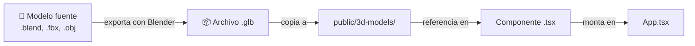
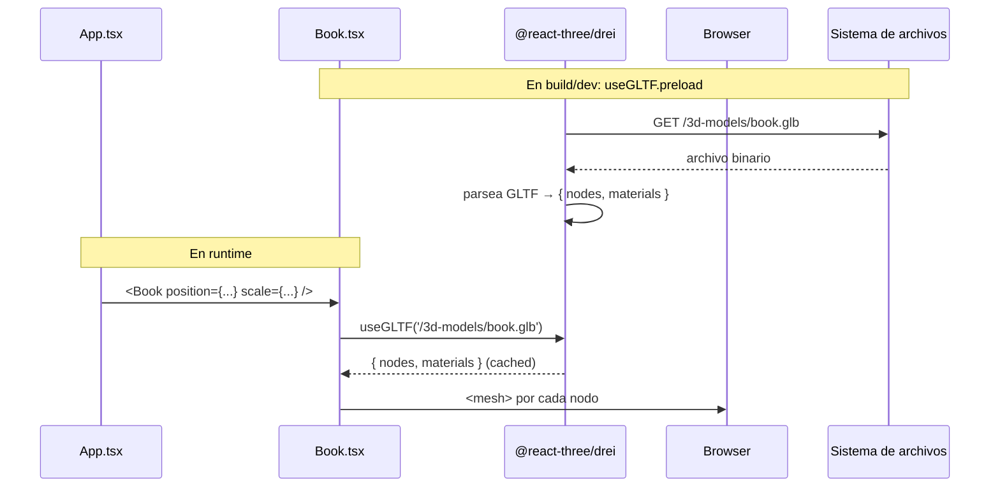

# Cómo añadir un modelo 3D

> Inicio > 03 — Componentes > Cómo añadir un modelo 3D

Tutorial paso a paso para añadir un nuevo objeto 3D al escritorio.

## Visión general del flujo



## Paso 1 — Obtener el modelo `.glb`

Si ya tienes un `.glb`, salta al paso 2. Si tienes un `.blend`, `.fbx` u otro formato:

1. Ábrelo en **Blender**.
2. Asegúrate de que el modelo está centrado en el origen y a una escala razonable (los objetos del proyecto están en torno a `0.5`–`2.5` unidades).
3. Renombra los nodos/mallas internas a algo descriptivo (`cuerpo`, `base`, etc.). Estos nombres aparecerán en `nodes` y `materials` dentro de `useGLTF`.
4. Ve a `File → Export → glTF Binary (.glb)`.
5. Marca las opciones:
   - ✅ Format: glTF Binary (`.glb`)
   - ✅ Compression (si está disponible)
   - ❌ Textures (las texturas ya van embebidas en `.glb`)
6. Exporta.

## Paso 2 — Colocar el `.glb` en `public/3d-models/`

```bash
# Ejemplo: añadir un "book.glb"
cp /ruta/al/book.glb public/3d-models/book.glb
```

Convención de nombres:

- **minúsculas** (excepto nombres propios: `gitHubLogo.glb`, `logoLinkedin.glb`).
- **separador `-`** (kebab-case), aunque hay inconsistencias heredadas: `porta-lapiceros.glb` vs `portaVasos.glb`. Por ahora respeta el estilo del proyecto.
- **mismo nombre que el componente** que lo va a consumir: `book.glb` ↔ `Book.tsx`.

## Paso 3 — Crear el componente React

### Opción A — Patrón simple con `AutoGLTF` (recomendado)

Para la mayoría de modelos usa el componente `AutoGLTF`, que recorre la escena del `.glb` y renderiza todas sus mallas automáticamente:

```tsx
// src/components/3d-models/Book.tsx
import AutoGLTF from '../physics/AutoGLTF';
import RigidObject from '../physics/RigidObject';
import { useGLTF } from '@react-three/drei';

export default function Model() {
  return (
    <RigidObject
      type="dynamic"
      colliders="cuboid"
      position={[0, 1.5, 0]}
      scale={1}
    >
      <AutoGLTF url="/3d-models/book.glb" />
    </RigidObject>
  );
}

useGLTF.preload('/3d-models/book.glb');
```

**Ventaja**: no necesitas saber los nombres exactos de los nodos del `.glb`. `AutoGLTF` los descubre recorriendo la escena.

> ⚠️ **Limitación de `AutoGLTF`**: si el `.glb` no incluye materiales en su JSON (es decir, `materials: []`), las mallas se renderizarán sin material (color blanco plano por defecto). Si esto ocurre, usa la **Opción B** (patrón manual) y asigna materiales manualmente. Los modelos `lamp.glb`, `mausePad.glb` y `portaVasos.glb` del proyecto usan este patrón.

### Opción B — Patrón manual (sólo si necesitas reescribir un material)

Si necesitas sustituir el material de una malla (como hace `Lapiz.tsx`), usa el patrón manual:

```tsx
import type { Mesh } from 'three';
import { useGLTF } from '@react-three/drei';
import RigidObject from '../physics/RigidObject';

export default function Model() {
  const { nodes, materials } = useGLTF('/3d-models/book.glb');

  return (
    <RigidObject type="dynamic" colliders="hull" position={[0, 1.5, 0]} scale={1}>
      <mesh
        castShadow
        receiveShadow
        geometry={(nodes.bookCover as Mesh).geometry}
        material={materials['book-cover']}
      />
      <mesh
        castShadow
        receiveShadow
        geometry={(nodes.bookPages as Mesh).geometry}
        material={materials['book-pages']}
      />
    </RigidObject>
  );
}

useGLTF.preload('/3d-models/book.glb');
```

**Importante**: para conocer los nombres exactos de los nodos y materiales del `.glb`, necesitas inspeccionarlo. Hay herramientas como [gltf.report](https://gltf.report/) (online) o [Blender](https://www.blender.org/) (local).

### Notas importantes

- **`useGLTF.preload(...)`** al final del archivo: pre-carga el modelo cuando se importa el módulo, evitando un flash de "loading" en el primer render.
- **`type="fixed"` vs `type="dynamic"`**: usa `fixed` para superficies/anclajes y `dynamic` para objetos que caen/colisionan/arrastran. Ver [Sistema de físicas](../04-escena-3d/sistema-de-fisicas.md).
- **`colliders="hull"` vs `cuboid`**: usa `hull` para formas irregulares y `cuboid` para cajas. Ver [Sistema de físicas](../04-escena-3d/sistema-de-fisicas.md).
- **`as Mesh`**: los nodos que devuelve `useGLTF` son `Object3D` por defecto; se castean a `Mesh` para acceder a `.geometry`.

## Paso 4 — (Solo si usaste el patrón manual) Inspeccionar nombres de nodos

Si optaste por el patrón manual y necesitas saber los nombres exactos de los nodos y materiales:

- Usa [gltf.report](https://gltf.report/) subiendo tu `.glb`.
- O ábrelo en Blender y lee los nombres en la jerarquía.
- O añade temporalmente `console.log(useGLTF('/3d-models/book.glb'))` en el componente y mira la consola.

Con `AutoGLTF` no necesitas este paso.

## Paso 5 — Montar en `App.tsx`

Edita `src/App.tsx`:

```tsx
// 1. Importar el nuevo componente
import Book from './components/3d-models/Book'

// 2. Dentro del <Canvas>, donde prefieras (la sección "// 3D Models"):
<Book
  position={[1.2, 1.48, 0.3]}
  scale={0.4}
  rotation={[0, 0.5, 0]}
/>
```

El orden de los componentes dentro de `<Canvas>` **no afecta al z-oculto** (eso depende de `position.z`). Pero sí afecta al **orden de instanciación**, lo que en teoría afecta al orden de pintado en objetos transparentes.

## Paso 6 — Verificar

1. `npm run dev`.
2. Abre el navegador en `http://localhost:5173`.
3. Busca tu modelo. Si no aparece:
   - ¿Salen errores en consola? Léelos.
   - ¿Está bien la ruta en `useGLTF`? Debe empezar por `/3d-models/`.
   - ¿Es correcto el `position`? Empieza siempre con valores simples como `[0, 1.5, 0]` para confirmar que aparece, y luego ajusta.
   - ¿El modelo es demasiado pequeño/grande? Ajusta `scale`.

## Diagrama del flujo de datos en runtime



## Checklist final

- [ ] El archivo `.glb` está en `public/3d-models/`.
- [ ] El componente `Book.tsx` está en `src/components/3d-models/`.
- [ ] Cada nodo del `.glb` está mapeado a un `<mesh>` con su `geometry` y `material`.
- [ ] Hay un `useGLTF.preload(...)` al final del archivo.
- [ ] El componente está importado y montado en `App.tsx`.
- [ ] El modelo se ve correctamente posicionado.
- [ ] `npm run lint` no reporta errores.
- [ ] `npm run build` compila sin errores de tipos.

## Documentos relacionados

- [Cómo crear un componente reutilizable](./como-crear-componente-reutilizable.md)
- [Guía de diseño de componentes](./guia-de-diseno-completo.md)
- [Posicionamiento de objetos](../04-escena-3d/posicionamiento-de-objetos.md)