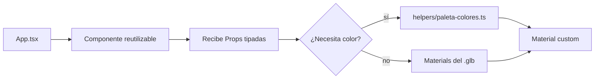

# Cómo crear un componente reutilizable

> Inicio > 03 — Componentes > Cómo crear un componente reutilizable

Hasta ahora hemos visto componentes "tontos": reciben `position/rotation/scale` y poco más. Pero algunos componentes admiten **props customizadas** para variar su aspecto en cada instancia. Hoy el único ejemplo es `Lapiz.tsx`.

## Cuándo aplicar este patrón

Aplica el patrón cuando:

- Un mismo modelo `.glb` se reutiliza **varias veces** con pequeñas variaciones (color, tamaño, animación).
- Quieres que el componente sea **"configurable"** desde `App.tsx` sin tocar el `.tsx` del componente.

**No apliques** el patrón si:

- El modelo se usa una sola vez.
- Las variaciones son menores (en ese caso crea 2-3 componentes distintos, como `Clock.tsx`).

## Caso de estudio: `Lapiz.tsx`

El componente `Lapiz` se usa **cuatro veces** en `App.tsx`, una por cada color de la paleta. En lugar de crear `LapizAmarillo.tsx`, `LapizRojo.tsx`, etc., parametrizamos.

### El componente

```tsx
// src/components/3d-models/Lapiz.tsx
import { Mesh, MeshStandardMaterial } from 'three'
import { useGLTF } from '@react-three/drei'
import type { JSX } from 'react';
import { paletaColores, type NombrePaleta, type IntensidadColor } from './../../helpers/paleta-colores';

interface Props {
  groupProps: JSX.IntrinsicElements['group'],
  paleta: NombrePaleta,
  intensidad: IntensidadColor,
}

export default function Model(props: Props) {
  const { nodes, materials } = useGLTF('/3d-models/lapiz.glb');

  const customMaterial = new MeshStandardMaterial({
    color: paletaColores[props.paleta][props.intensidad]
  });

  return (
    <group {...props.groupProps} dispose={null}>
      <mesh
        castShadow
        receiveShadow
        geometry={(nodes.baseBorrador as Mesh).geometry}
        material={materials.baseBorrador}
      />
      {/* … otros meshes con sus materiales originales … */}
      <mesh
        castShadow
        receiveShadow
        geometry={(nodes.cuerpoLapiz as Mesh).geometry}
        material={customMaterial}   // ← aquí aplicamos el material dinámico
      />
      {/* … */}
    </group>
  )
}

useGLTF.preload('/3d-models/lapiz.glb');
```

### Cómo se invoca desde el padre

```tsx
// src/App.tsx
<Lapiz
  key={1}
  groupProps={{
    position: [-2, 1.48, -0.4],
    scale: 0.9
  }}
  intensidad={500}
  paleta='amarillos'
/>

<Lapiz
  key={2}
  groupProps={{
    position: [-1.96, 1.48, -0.4],
    scale: 0.9
  }}
  intensidad={500}
  paleta='rojos'
/>

<Lapiz
  key={3}
  groupProps={{
    position: [-2, 1.48, -0.28],
    scale: 0.9
  }}
  intensidad={500}
  paleta='azulGrisOscuro'
/>

<Lapiz
  groupProps={{
    position: [-1.96, 1.48, -0.28],
    scale: 0.9
  }}
  intensidad={500}
  paleta='verdes'
/>
```

### Observaciones clave

1. **`groupProps`** agrupa las props de `<group>` (position, rotation, scale). Es un objeto único porque JSX no permite spread mixto con tipado estricto si hay otras props.

2. **`key={…}`** en React: cada instancia es un componente independiente en el árbol virtual. Las claves son útiles si más adelante se hace render condicional.

3. **Tipos importados de la paleta**: `NombrePaleta` y `IntensidadColor` restringen los valores posibles a las claves válidas del helper. Si pasas `'rosa'` o `700`, TypeScript grita.

4. **Material dinámico**: el `cuerpoLapiz` (el cuerpo del lápiz) recibe un `MeshStandardMaterial` con el color calculado a partir de la paleta. El resto de mallas mantienen sus materiales originales.

5. **No se modifica el `.glb`**. La variación se hace 100% en código.

## Diagrama del patrón



## Pasos para crear tu propio componente reutilizable

### 1. Define la interfaz de Props

```tsx
interface Props {
  groupProps: JSX.IntrinsicElements['group']
  // tus props custom:
  paleta?: NombrePaleta
  intensidad?: IntensidadColor
  // ...
}
```

Haz las props custom **opcionales** (`?`) para que el componente siga siendo usable sin ellas (modo "actual").

### 2. Decide qué varía

- ¿Color de una pieza concreta? → Crea un material dinámico para esa malla.
- ¿Animación? → Usa `useFrame` y una prop de control.
- ¿Visibilidad de piezas? → Usa `visible` en `<mesh>` controlado por una prop.

### 3. Usa tipos exportados del helper

Si la variación viene de un set cerrado de opciones, **exporta un tipo** en el helper. Ver [Sistema de colores](../05-estilos/sistema-de-colores.md).

### 4. Aplica el material dinámico con cuidado

`new MeshStandardMaterial(...)` crea un material nuevo cada render. Para evitar fugas de memoria y renders innecesarios, en versiones más elaboradas se usa `useMemo`:

```tsx
import { useMemo } from 'react';

const customMaterial = useMemo(
  () => new MeshStandardMaterial({ color: paletaColores[props.paleta!][props.intensidad!] }),
  [props.paleta, props.intensidad]
);
```

En el `Lapiz.tsx` actual no se usa `useMemo`; es una mejora razonable a futuro.

## Documentos relacionados

- [Cómo añadir un modelo 3D](./como-anadir-modelo-3d.md)
- [Guía de diseño de componentes](./guia-de-diseno-completo.md)
- [Sistema de colores](../05-estilos/sistema-de-colores.md)