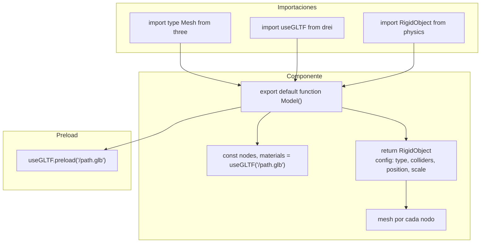

# Guía de diseño de componentes

> Inicio > 03 — Componentes > Guía de diseño

Convenciones, patrones y reglas no escritas que se han establecido en el proyecto.

## Convenciones de nombrado

### Archivos

| Tipo | Convención | Ejemplo |
|---|---|---|
| Componentes 3D | PascalCase + `.tsx` | `DeskTable.tsx` |
| Componentes de escena | PascalCase + `.tsx` | `CamaraController.tsx` |
| Componentes de environment | PascalCase + `.tsx` | `Room.tsx`, `Plant.tsx` |
| Componentes de physics | PascalCase + `.tsx` | `RigidObject.tsx` |
| Hooks | camelCase con prefijo `use` + `.ts` | `useDragObject.ts` |
| Helpers | kebab-case + `.ts` | `paleta-colores.ts` |

### Componentes

- Cada componente exporta **por defecto** (`export default function Model(...)`).

```tsx
// ✅ Patrón actual
export default function Model() {
  // ...
}
```

### Props

- **Componentes simples**: ya no reciben props directamente. Las props de `<group>` (position, rotation, scale) se pasan **al `<RigidObject>`**.
- **Componentes reutilizables**: una interfaz `interface Props` propia, que **siempre** incluye `groupProps` para las props del `<group>` interno (para Lapiz.tsx se mantiene por compatibilidad con la paleta).

## Anatomía de un componente "estándar"

### Antes (sin la app física)

```tsx
export default function Model(props: JSX.IntrinsicElements['group']) {
  const { nodes, materials } = useGLTF('/3d-models/desk-table.glb');

  return (
    <group {...props} dispose={null}>
      {/* meshes */}
    </group>
  );
}
```

### Ahora (con la app física)

```tsx
export default function Model() {
  const { nodes, materials } = useGLTF('/3d-models/desk-table.glb');

  return (
    <RigidObject type="fixed" colliders="hull" position={[0, -0.5, 0]} draggable={false}>
      <mesh
        castShadow
        receiveShadow
        geometry={(nodes.estructura as Mesh).geometry}
        material={materials['base-table']}
      />
      {/* más meshes */}
    </RigidObject>
  );
}

useGLTF.preload('/3d-models/desk-table.glb');
```

Elementos obligatorios:

| Elemento | Por qué |
|---|---|
| `<RigidObject type="..." colliders="...">` | Convierte el modelo en cuerpo físico. |
| `useGLTF('/ruta/al.glb')` | Carga el modelo. |
| `<mesh castShadow receiveShadow>` | Sombras. |
| `geometry={...} material={...}` | Cada nodo se mapea a una `<mesh>`. |
| `useGLTF.preload(...)` | Pre-carga para evitar flash de loading. |

## Cuándo usar cada tipo de `<RigidObject>`

| Caso | type | colliders | draggable |
|---|---|---|---|
| Superficie principal (escritorio, suelo) | `fixed` | `cuboid` | `false` |
| Anclaje (monitor, mausePad, portaVasos) | `fixed` | `cuboid` | `false` |
| Objeto arrastrable (taza, reloj, lámpara…) | `dynamic` | `cuboid` | `true` (por defecto) |

> ⚠️ **`colliders="hull"`** puede causar problemas cuando el `RigidBody` envuelve muchas mallas (como el teclado con 102). Rapier intenta combinar todas las geometrías en un único hull, lo cual es costoso e inestable. **Usa `cuboid` salvo que necesites específicamente una forma más fiel**.

## Reglas de materiales

- Los materiales vienen **del propio `.glb`**, no se redefinen en TS.
- **Excepción**: `Lapiz.tsx` redefine el material del cuerpo (`cuerpoLapiz`) usando `MeshStandardMaterial` con un color dinámico.

## Reglas de sombras

- Todos los meshes llevan `castShadow` y `receiveShadow`.
- El sistema de sombras depende de:
    - Que `<Canvas>` tenga la prop `shadows` (ya está activo).
    - Que la `directionalLight` principal tenga `castShadow` (ya está).
    - Que los meshes tengan `castShadow` y `receiveShadow` (ya están).

## Tipos importantes

### `JSX.IntrinsicElements['group']`

Útil sólo para `Lapiz.tsx` que mantiene la interfaz previa. Para los nuevos componentes, las props se pasan directamente al `<RigidObject>`.

### `Mesh` de three.js

```tsx
import type { Mesh } from 'three';

const node = useGLTF('/something.glb').nodes.foo;
const mesh = node as Mesh;
mesh.geometry; // ahora sí existe
```

### Tipos del helper de paleta

```tsx
import type { NombrePaleta, IntensidadColor } from './../../helpers/paleta-colores';

const p: NombrePaleta = 'rojos';     // ✅ válido
const i: IntensidadColor = 500;       // ✅ válido
```

## Patrones que **no** debes seguir

- ❌ **`useHelper` en producción**: ya eliminado de `Light.tsx` y `Controls.tsx`.
- ❌ **No anidar `<Canvas>`**: sólo hay un `<Canvas>` en `App.tsx`.
- ❌ **No usar `useEffect` para cargar modelos**: usa siempre `useGLTF`.
- ❌ **No usar `onPointerDown` directamente en el `<RigidBody>`**: no funciona. Hay que ponerlo en un `<group>` hijo (que es lo que hace `RigidObject` internamente).
- ❌ **No mutar `gl.domElement.style.cursor` directamente desde un callback**: dispara errores de `react-hooks/immutability`. Usa un helper que opere sobre el canvas del DOM directamente.

## Diagrama: anatomía de un componente 3D con físicas



## Checklist de un componente bien hecho

- [ ] `export default function` al final del archivo.
- [ ] `useGLTF(...)` con la ruta correcta.
- [ ] `<RigidObject>` con `type` y `colliders` apropiados.
- [ ] Cada nodo del gráfico mapeado a un `<mesh>`.
- [ ] `castShadow` y `receiveShadow` en cada mesh.
- [ ] `useGLTF.preload(...)` al final del archivo.
- [ ] Si es dinámico y arrastrable, `draggable` por defecto ya es `true`.
- [ ] Si es fijo, `draggable={false}` explícito.
- [ ] Sin imports sin usar.
- [ ] Sin `console.log` olvidados.

## Documentos relacionados

- [Cómo añadir un modelo 3D](./como-anadir-modelo-3d.md)
- [Cómo crear un componente reutilizable](./como-crear-componente-reutilizable.md)
- [Sistema de escena](../04-escena-3d/sistema-de-escena.md)
- [Sistema de físicas](../04-escena-3d/sistema-de-fisicas.md)