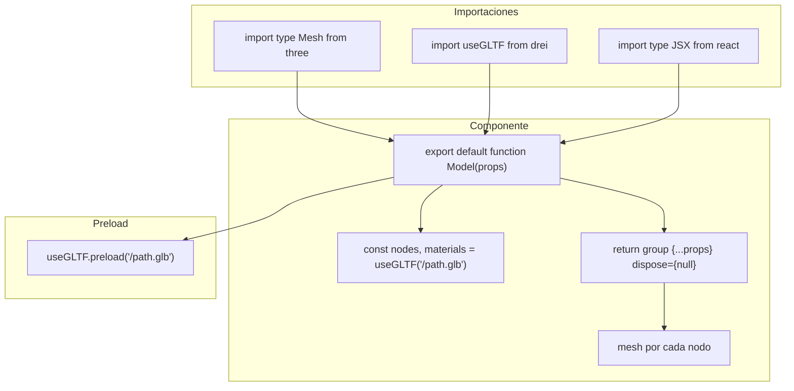

# Guía de diseño de componentes

> Inicio > 03 — Componentes > Guía de diseño

Convenciones, patrones y reglas no escritas que se han establecido en el proyecto.

## Convenciones de nombrado

### Archivos

| Tipo | Convención | Ejemplo |
|---|---|---|
| Componentes 3D | PascalCase + `.tsx` | `DeskTable.tsx` |
| Componentes de escena | PascalCase + `.tsx` | `CamaraController.tsx` |
| Helpers/utilidades | kebab-case + `.ts` | `paleta-colores.ts` |
| Hooks | camelCase con prefijo `use` + `.ts` | `useModelo.ts` (cuando se cree) |

### Componentes

- Cada componente exporta **por defecto** (`export default function Model(...)`).
- El nombre interno de la función suele ser literalmente `Model` (no el nombre del archivo). Es una convención inconsistente que se mantiene por legado. Podrías mejorarlo renombrando a `DeskTable`, `Clock`, etc.

```tsx
// ✅ Patrón actual
export default function Model(props: JSX.IntrinsicElements['group']) {
  // ...
}

// ✅ Alternativa más clara
export default function DeskTable(props: JSX.IntrinsicElements['group']) {
  // ...
}
```

### Props

- **Componentes simples**: `props: JSX.IntrinsicElements['group']` — tipado completo del `<group>` de three.js (position, rotation, scale, children…).
- **Componentes reutilizables**: una interfaz `interface Props` propia, que **siempre** incluye `groupProps` para las props de `<group>`.

## Anatomía de un componente "estándar"

```tsx
import type { Mesh } from 'three'
import { useGLTF } from '@react-three/drei'
import type { JSX } from 'react/jsx-dev-runtime'

export default function Model(props: JSX.IntrinsicElements['group']) {
  const { nodes, materials } = useGLTF('/3d-models/desk-table.glb')

  return (
    <group {...props} dispose={null}>
      <mesh
        castShadow
        receiveShadow
        geometry={(nodes.estructura as Mesh).geometry}
        material={materials['base-table']}
      />
      <mesh
        castShadow
        receiveShadow
        geometry={(nodes.table as Mesh).geometry}
        material={materials['option-2-table']}
      />
    </group>
  )
}

useGLTF.preload('/3d-models/desk-table.glb')
```

Elementos obligatorios:

| Elemento | Por qué |
|---|---|
| `useGLTF('/ruta/al.glb')` | Carga el modelo. La ruta empieza por `/3d-models/` porque `public/3d-models/` se sirve en `/3d-models/`. |
| `<group {...props} dispose={null}>` | Spread de las props + evita dispose de recursos. |
| `<mesh castShadow receiveShadow>` | Sombras: el modelo **emite** y **recibe** sombras. |
| `geometry={...} material={...}` | Cada nodo se mapea a una `<mesh>`. |
| `useGLTF.preload(...)` | Pre-carga para evitar flash de loading. |

## Reglas de materiales

- Los materiales vienen **del propio `.glb`**, no se redefinen en TS.
- Excepción:** `Lapiz.tsx` redefine el material del cuerpo (`cuerpoLapiz`) usando `MeshStandardMaterial` con un color dinámico. Es el único caso.

## Reglas de sombras

- Prácticamente todos los meshes llevan `castShadow` y `receiveShadow`.
- El sistema de sombras depende de:
    - Que la `<directionalLight>` tenga `castShadow` (ver [Sistema de luces](../04-escena-3d/sistema-de-luces.md)).
    - Que el `Canvas` tenga `shadows` activado (en este proyecto no se ha activado explícitamente, así que **las sombras pueden no estar funcionando**).

## Tipos importantes

### `JSX.IntrinsicElements['group']`

Es el tipo de las props válidas para `<group>` en react-three-fiber. Incluye `position`, `rotation`, `scale`, `children`, `dispose`, `onClick`, etc.

```tsx
function MyComponent(props: JSX.IntrinsicElements['group']) {
  // props.position es [number, number, number] | Vector3 | undefined
  // props.scale es [number, number, number] | number | undefined
}
```

### `Mesh` de three.js

```tsx
import type { Mesh } from 'three';

const node = useGLTF('/something.glb').nodes.foo;
// node es Object3D por defecto. Hay que castearlo a Mesh:
const mesh = node as Mesh;
mesh.geometry; // ahora sí existe
```

### Tipos del helper de paleta

```tsx
import type { NombrePaleta, IntensidadColor } from './../../helpers/paleta-colores';

const p: NombrePaleta = 'rojos';     // ✅ válido
const i: IntensidadColor = 500;       // ✅ válido (uno de 100|200|300|400|500)

const p2: NombrePaleta = 'rosa';     // ❌ error TS
const i2: IntensidadColor = 700;      // ❌ error TS
```

## Patrones que **no** debes seguir

- ❌ **`useHelper` en producción**: `Light.tsx` lo usa para visualizar el helper de la luz. Útil en debug, no en producción. Si lo mantienes, elimina el import.
- ❌ **`useHelper` con `ref.current`**: en `Controls.tsx` se llama `useHelper(refLight.current, ...)` lo cual es un bug menor: la primera vez `current` es `null` y se logueará un warning.
- ❌ **No anidar `Canvas`**: sólo hay un `<Canvas>` en `App.tsx`. No crees nuevos.
- ❌ **No usar `useEffect` para cargar modelos**: usa siempre `useGLTF` que ya gestiona el ciclo de vida.

## Diagrama: anatomía de un componente 3D



## Checklist de un componente bien hecho

- [ ] `export default function` al final del archivo.
- [ ] `useGLTF(...)` con la ruta correcta.
- [ ] `<group {...props} dispose={null}>`.
- [ ] Cada nodo del `.glb` mapeado a un `<mesh>`.
- [ ] `castShadow` y `receiveShadow` en cada mesh.
- [ ] `useGLTF.preload(...)` al final del archivo.
- [ ] Sin imports sin usar (TypeScript con `noUnusedLocals` fallará).
- [ ] Sin `console.log` olvidados.
- [ ] Sin `useHelper` activo en producción.

## Documentos relacionados

- [Cómo añadir un modelo 3D](./como-anadir-modelo-3d.md)
- [Cómo crear un componente reutilizable](./como-crear-componente-reutilizable.md)
- [Sistema de escena](../04-escena-3d/sistema-de-escena.md)
- [Sistema de colores](../05-estilos/sistema-de-colores.md)