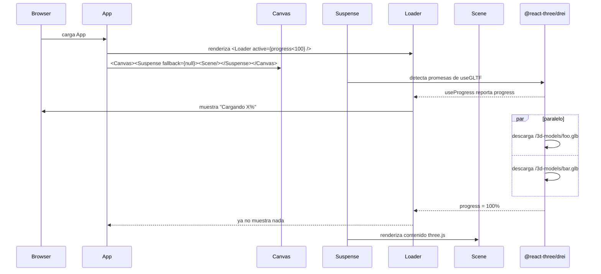
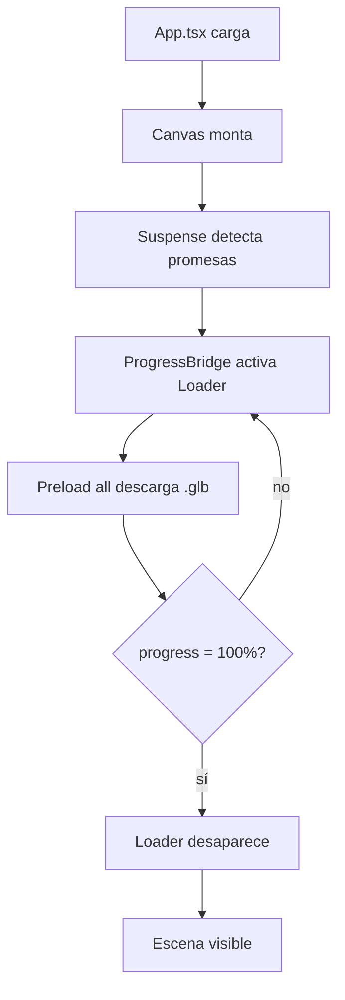

# Loading y Suspense

> Inicio > 04 — Escena 3D > Loading y Suspense

Cómo se gestiona la carga asíncrona de los modelos `.glb` y el feedback visual mientras dura.

## ⚠️ Regla fundamental

**El `<Loader />` HTML debe estar FUERA del `<Canvas>`**.

Dentro del `<Canvas>` de react-three-fiber, todos los elementos deben ser parte de la jerarquía de three.js (`<mesh>`, `<group>`, `<directionalLight>`, etc.). Si metes un `<div>` dentro, R3F intenta interpretarlo como un objeto three.js y lanza:

```
R3F: Div is not part of the THREE namespace! Did you forget to extend?
```

Por eso este proyecto renderiza el Loader como un elemento HTML fijo superpuesto, controlado por `useProgress` (que internamente se suscribe a un store global de drei).

## Visión general



## Componentes

### `App.tsx`

Estructura actual:

```tsx
const App = () => (
  <ProgressBridge>
    <div id="canvas-container">
      <Canvas shadows>
        <Suspense fallback={null}>
          <Scene />
        </Suspense>
      </Canvas>
    </div>
  </ProgressBridge>
);
```

Tres elementos clave:

1. **`ProgressBridge`**: controla cuándo aparece el Loader según `useProgress`.
2. **`<Canvas>`**: el mundo 3D, sin HTML dentro.
3. **`<Suspense fallback={null}>`**: gestiona la promesa de carga. El `fallback` es `null` porque el indicador visual está fuera.

### `Loader.tsx`

Componente HTML a pantalla completa:

```tsx
<Loader active={isLoading} />
```

Sigue el wireframe de Figma de la pantalla de carga. Mientras `active` es `true` muestra, con los colores de la paleta del proyecto (`COLORS`, ver [Sistema de colores](../05-estilos/sistema-de-colores.md)): fondo `azulGrisOscuro[100]`, superficies `azulGrisOscuro[300]`, bordes `azulGrisClaro[400]` y acento `amarillos[500]` en el logo, la barra y las teclas:

- Logo "3D", nombre (`OWNER_NAME`, provisional "John Doe") y subtítulo (`OWNER_TAGLINE`).
- **Barra de progreso (HU-17)** ligada a `useProgress`, con el estado a la izquierda ("Cargando modelos 3D…", "Cargando texturas…" o "Preparando escena…", según el `item` que se esté descargando) y el porcentaje a la derecha. La barra guarda el máximo alcanzado: cuando el chunk lazy de físicas encola más modelos, `progress` baja, pero la barra no retrocede.
- **Consejo rotativo** de controles ("Consejo: usa W A S D para mover el vehículo"…), que cambia cada `TIP_INTERVAL` ms. Las teclas se leen de `keyboardMap` con `keysFor`, igual que en `ControlsHelp`.

Cuando `active` pasa a `false`, la pantalla se desvanece (`FADE_OUT_MS`) y después devuelve `null`.

Usa `useProgress` de `@react-three/drei`, que internamente se suscribe al `GLTFLoader` y reporta el porcentaje total de assets descargados, **incluso si está fuera del `<Canvas>`**.

### `<Preload all />`

Componente de `@react-three/drei` que fuerza la precarga de **todos** los assets declarados con `useGLTF.preload(...)` antes de que se renderice la escena. Garantiza que la barra de progreso avance hasta el 100%.

## Flujo de carga



## Configuración

### `useGLTF.preload(...)` por componente

Cada componente que usa `useGLTF` declara un `preload` al final del archivo:

```tsx
useGLTF.preload('/3d-models/lamp.glb');
```

Esto no descarga el archivo inmediatamente, pero **lo registra** para que `<Preload all />` sepa que tiene que cargarlo.

### Orden de carga

Los `.glb` se descargan en paralelo (no en serie). El progreso global es la suma de bytes descargados / total.

## Personalizar el aspecto del loader

`Loader.tsx` está implementado con estilos inline. Para cambiar el aspecto, edita el archivo. Algunos cambios comunes:

| Cambio | Dónde |
|---|---|
| Nombre y subtítulo | `OWNER_NAME`, `OWNER_TAGLINE` |
| Colores (fondo, bordes, acento, texto) | objeto `COLORS` (tonos de `paleta-colores.ts`) |
| Consejos mostrados | array `TIPS` |
| Tiempo por consejo | `TIP_INTERVAL` |
| Duración del fundido de salida | `FADE_OUT_MS` |

## Limitaciones

- ❌ **El loader sólo se muestra en la carga inicial**. Una vez la escena está lista, recargar los `.glb` no vuelve a mostrar el loader.
- ❌ **No hay loading específico por modelo**: si un modelo tarda más que otro, el progreso global no refleja cuál.
- ❌ **No hay manejo de errores**: si un `.glb` falla al cargar (404 o corrupto), `<Suspense>` quedará en estado de error.

## Documentos relacionados

- [Sistema de escena](./sistema-de-escena.md)
- [Cómo añadir un modelo 3D](../03-componentes/como-anadir-modelo-3d.md)