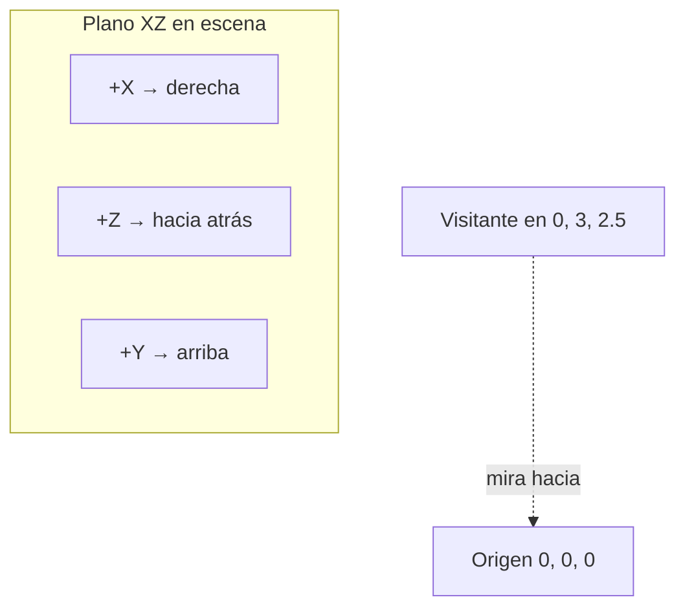
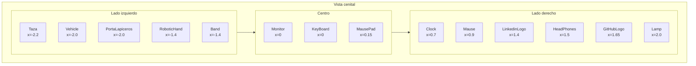
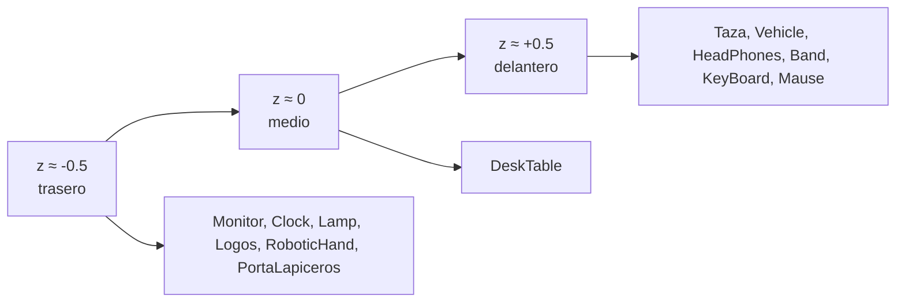

# Posicionamiento de objetos

> Inicio > 04 — Escena 3D > Posicionamiento de objetos

Dónde está cada modelo en el espacio 3D y cómo ajustar sus coordenadas.

## Sistema de coordenadas

three.js usa un sistema **diestro (right-handed)**. Por defecto en el proyecto:



- **+X**: hacia la derecha del visitante.
- **+Y**: hacia arriba.
- **+Z**: hacia el visitante (hacia la cámara).

## Cámara de referencia

```tsx
// App.tsx
<Canvas shadows camera={{ position: [0, 3, 4] }}>

// Controls.tsx
<OrbitControls makeDefault target={[0, 1.5, 0]} enableZoom={false} enableRotate />
```

La cámara está en `(0, 3, 4)` mirando al punto `(0, 1.5, 0)`. Esto significa que:

- El **centro del escritorio** está cerca de `(0, 1.5, 0)` (altura de la mesa).
- Los objetos están alineados principalmente sobre el eje X (izquierda-derecha).
- Z varía un poco hacia adelante/atrás para dar profundidad.

## Posiciones de los modelos en `App.tsx`

| Modelo | `position` | `scale` | `rotation` | Notas |
|---|---|---|---|---|
| `<DeskTable>` | `[0, -0.5, 0]` | (defecto) | (defecto) | La base, debajo de todo. |
| `<Taza>` | `[-2.2, 1.48, 0.56]` | `0.6` | (defecto) | Esquina izquierda-frontal. |
| `<Monitor>` | `[0, 1.43, -0.48]` | `1` | `[0, 4.7, 0]` | Centro, girado casi 270° (mirando al visitante). |
| `<KeyBoard>` | `[0, 1.55, 0.38]` | `1.7` | `[0, 0.05, 0]` | Centro-frontal. |
| `<Mause>` | `[0.9, 1.48, 0.38]` | `2.4` | `[0, 0.3, 0]` | Derecha del teclado. |
| `<RoboticHand>` | `[-1.4, 1.48, -0.5]` | `1.2` | `[0, -4.6, 0]` | Izquierda, girado. |
| `<HeadPhones>` | `[1.5, 1.57, 0.4]` | `1.6` | `[0, 0.7, -1.68]` | Derecha-frontal, ladeado. |
| `<Clock>` | `[0.7, 1.476, -0.3]` | `4` | `[0, 0, 0]` | Derecha, en la pared trasera. |
| `<Band>` | `[-1.4, 1.535, 0.4]` | `0.45` | `[0, 1, 1.46]` | Izquierda-frontal. |
| `<PortaLapiceros>` | `[-2, 1.48, -0.4]` | `1` | (defecto) | Esquina izquierda-trasera. |
| `<Lapiz>` (1) | `[-2, 1.48, -0.4]` | `0.9` | (defecto) | Dentro del portalápices. |
| `<Lapiz>` (2) | `[-1.96, 1.48, -0.4]` | `0.9` | (defecto) | Junto al primero. |
| `<Lapiz>` (3) | `[-2, 1.48, -0.28]` | `0.9` | (defecto) | Segundo nivel del portalápices. |
| `<Lapiz>` (4) | `[-1.96, 1.48, -0.28]` | `0.9` | (defecto) | Cuarto lápiz. |
| `<Lamp>` | `[2, 1.47, -0.3]` | `1.5` | `[0, 5.5, 0]` | Esquina derecha-trasera, ladeado. |
| `<LinkedinLogo>` | `[1.4, 1.49, -0.3]` | `0.4` | (defecto) | Derecha-trasera. |
| `<GitHubLogo>` | `[1.65, 1.49, -0.3]` | `0.45` | (defecto) | Al lado del logo de LinkedIn. |
| `<Vehicle>` | `[-2, 1.49, 0.2]` | `0.15` | `[0, 1, 0]` | Esquina izquierda-frontal, pequeño. |
| `<MausePad>` | `[0.15, 1.485, 0.35]` | `0.3` | `[0, 0, 0]` | Bajo el ratón. |

> Nota: `<PortaVasos>` figura en el código pero la tabla lo omite por brevedad.

## Diagrama cenital (vista desde arriba)



## Diagrama de profundidad (eje Z)



## Cómo ajustar posiciones

### Mover un objeto más a la derecha

```tsx
// Antes
<DeskTable position={[0, -0.5, 0]} />

// Después
<DeskTable position={[1, -0.5, 0]} />
```

### Cambiar la rotación

Las rotaciones van en radianes, no grados:

```tsx
// Girar 90° en el eje Y (π/2 radianes ≈ 1.5708)
<Monitor position={[0, 1.43, -0.48]} scale={1} rotation={[0, Math.PI / 2, 0]} />
```

### Cambiar la escala

```tsx
// Más grande
<Clock position={[0.7, 1.476, -0.3]} scale={8} rotation={[0, 0, 0]} />
```

`scale` puede ser:
- Un número único: aplica a X, Y y Z por igual.
- Una tupla `[x, y, z]`: escala independiente por eje.

## Tips de depuración

Si pierdes un objeto de vista:

1. **Cámbialo a `[0, 1.5, 0]` con `scale={10}`** para confirmar que existe.
3. **Quita la rotación** (`rotation={[0, 0, 0]}`).
4. **Quita la escala** (`scale={1}`).
5. Reduce `position` paso a paso.

## Documentos relacionados

- [Sistema de escena](./sistema-de-escena.md)
- [Sistema de luces](./sistema-de-luces.md)
- [Cómo añadir un modelo 3D](../03-componentes/como-anadir-modelo-3d.md)