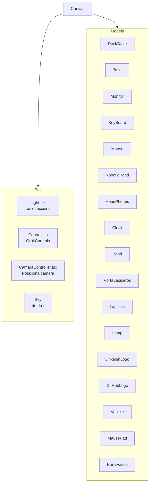
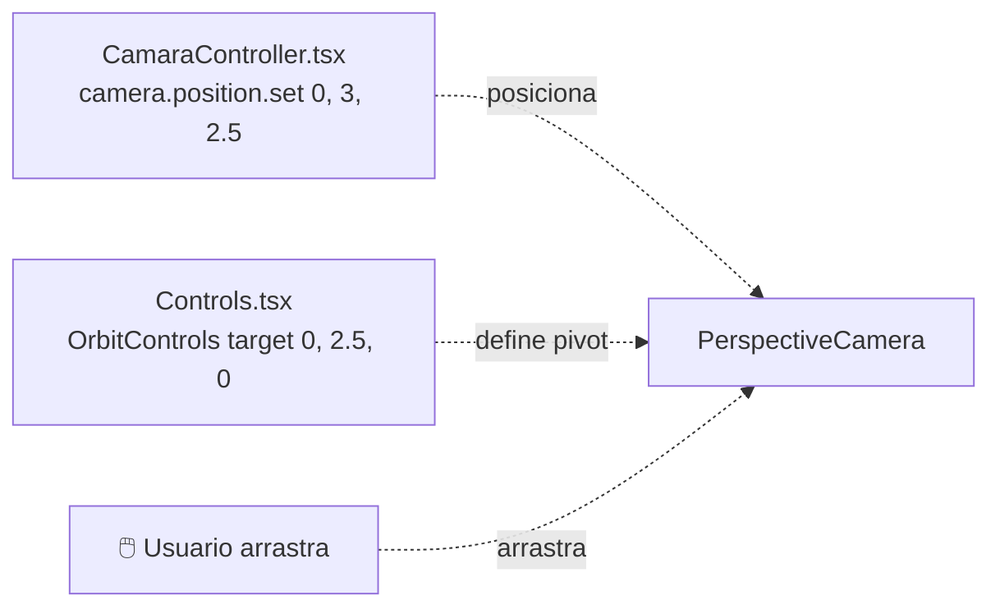
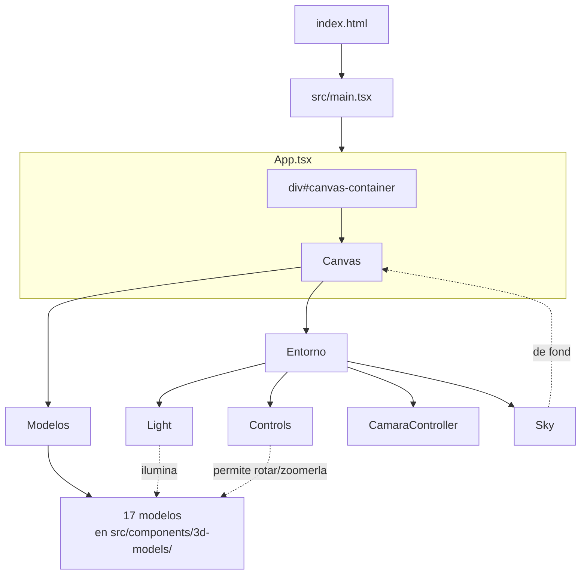

# Sistema de escena

> Inicio > 04 — Escena 3D > Sistema de escena

Cómo está organizada la escena 3D, desde el `<Canvas>` hasta cada modelo individual.

## El componente raíz: `App.tsx`

`App.tsx` es **el único punto** donde se monta la escena. Su estructura simplificada es:

```tsx
<div id="canvas-container">
  <Canvas style={{ height: '100vh', width: '100%' }}>
    {/* Entorno */}
    <Light />
    <Controls />
    <CamaraController />
    <Sky />

    {/* Modelos 3D */}
    <DeskTable position={[0, -0.5, 0]} />
    <Taza position={[-2.2, 1.48, 0.56]} scale={0.6} />
    {/* … 15 modelos más … */}
  </Canvas>
</div>
```

### Puntos clave

- **`<div id="canvas-container">`**: contenedor HTML. El `<Canvas>` ocupa todo el alto de la ventana.
- **`<Canvas>`** (de `@react-three/fiber`): crea una escena three.js completa y la renderiza en un `<canvas>` WebGL.
- **No se pasa prop `shadows`**, así que por defecto las sombras **están desactivadas**. Esto contrasta con el hecho de que cada mesh tiene `castShadow` y `receiveShadow` (sería necesario activarlas para que funcionen).
- **No se pasa `camera`**: el `<Canvas>` crea una cámara por defecto (PerspectiveCamera). `CamaraController` reposiciona esa cámara después.

## Las dos capas de la escena

El contenido del `<Canvas>` se organiza conceptualmente en dos capas:



### Capa de entorno (`scene-environment/`)

Define las condiciones globales: luz, controles, cámara, cielo.

- **`Light.tsx`** — Una luz direccional apuntando a `(0, 1.5, 0)` desde `(0, 4, 3)` con intensidad 5.
- **`Controls.tsx`** — `OrbitControls` apuntando a `(0, 2.5, 0)` con zoom y rotación activados.
- **`CamaraController.tsx`** — Posiciona la cámara en `(0, 3, 2.5)`.
- **`<Sky>`** — Cielo procedural de `@react-three/drei`.

### Capa de modelos (`3d-models/`)

Cada componente renderiza un modelo `.glb` en una posición concreta.

## El `<Canvas>` en detalle

```tsx
<Canvas style={{ height: '100vh', width: '100%' }}>
```

| Propiedad | Valor actual | Notas |
|---|---|---|
| `style.height` | `'100vh'` | Ocupa toda la ventana vertical. |
| `style.width` | `'100%'` | Ocupa todo el ancho del contenedor. |
| `shadows` | (no se pasa) | Las sombras **no se renderizan** actualmente. Para activarlas, añadir `shadows`. |
| `gl` | (no se pasa) | Usa `WebGLRenderer` por defecto. |
| `camera` | (no se pasa) | `PerspectiveCamera` por defecto con fov 75, near 0.1, far 1000. |

## Cámara y controles



- **Cámara** queda fija en `(0, 3, 2.5)` (vista desde arriba-derecha hacia el escritorio).
- **Target** de los `OrbitControls` es `(0, 2.5, 0)` (centro del escritorio a media altura).
- El usuario puede **rotar** arrastrando con el ratón y **hacer zoom** con la rueda.

## Render loop

`@react-three/fiber` se encarga del render loop automáticamente. Internamente:

```mermaid
sequenceDiagram
    participant Loop
    participant R3F as react-three-fiber
    participant Three as three.js
    participant GL as WebGLRenderer

    Loop->>R3F: requestAnimationFrame
    R3F->>Three: scene.update()
    R3F->>GL: renderer.render(scene, camera)
    GL-->>Browser: frame dibujado en <canvas>
```

No necesitas `useFrame` salvo que quieras animaciones (que es lo que hace que en este proyecto todo sea estático).

## Diagrama completo de la escena



## Limitaciones conocidas

- ❌ **No hay sombras activas**: aunque cada mesh lo solicita, falta `shadows` en el `<Canvas>`.
- ❌ **No hay animaciones**: la escena es estática salvo por la cámara.
- ❌ **No hay post-processing**: no hay `EffectComposer`, bloom, tone-mapping, etc.
- ❌ **No hay interactividad por mesh**: no hay `onClick` ni `onPointerOver` definidos.

## Documentos relacionados

- [Sistema de luces](./sistema-de-luces.md)
- [Posicionamiento de objetos](./posicionamiento-de-objetos.md)
- [Visión general](../01-arquitectura/vision-general.md)