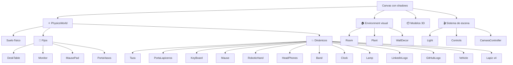
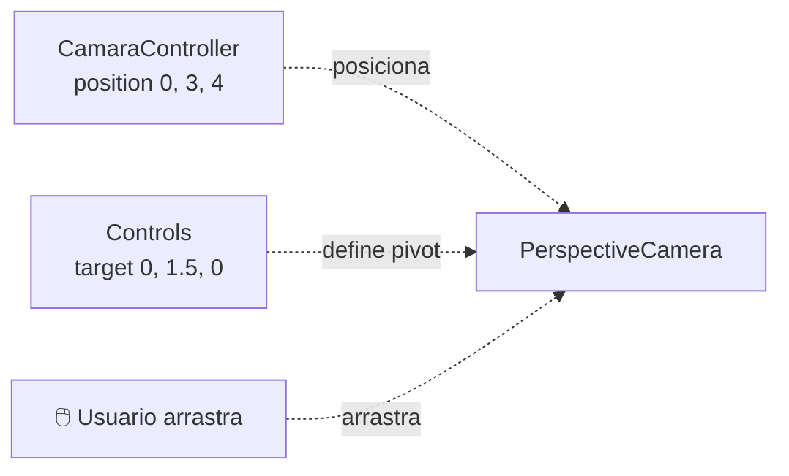
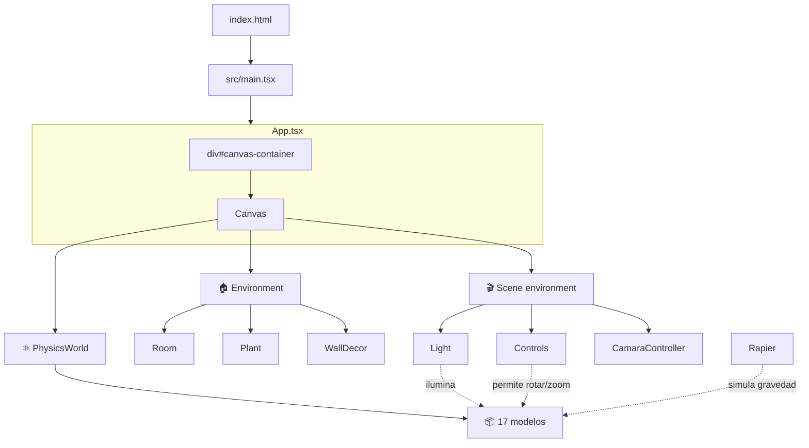

# Sistema de escena

> Inicio > 04 — Escena 3D > Sistema de escena

Cómo está organizada la escena 3D: el `<Canvas>`, el environment visual, las físicas, y los modelos.

## El componente raíz: `App.tsx`

```tsx
<div id="canvas-container">
  <Canvas shadows style={{ height: '100vh', width: '100%' }}>
    {/* Físicas: envuelve los objetos físicos */}
    <PhysicsWorld>
      {/* Fijos */}
      <DeskTable />
      <Monitor />
      <MausePad />
      <PortaVasos />

      {/* Dinámicos */}
      <Taza />
      <PortaLapiceros />
      <KeyBoard />
      <Mause />
      <RoboticHand />
      <HeadPhones />
      <Band />
      <Clock />
      <Lamp />
      <LinkedinLogo />
      <GitHubLogo />
      <Vehicle />
      <Lapiz ... />
      <Lapiz ... />
      <Lapiz ... />
      <Lapiz ... />
    </PhysicsWorld>

    {/* Environment visual (sin físicas) */}
    <Room />
    <Plant />
    <WallDecor />

    {/* Escena */}
    <Light />
    <Controls />
    <CamaraController />
  </Canvas>
</div>
```

### Puntos clave

- **`shadows` activado**: necesario para que las sombras del `directionalLight` se rendericen.
- **`<PhysicsWorld>`** envuelve SOLO los objetos físicos (fijos + dinámicos). El environment visual está fuera.
- **El orden de los elementos dentro de `<PhysicsWorld>` no afecta a la simulación**, pero el orden dentro del `<Canvas>` puede afectar al render (z-buffer).

## Las cuatro capas de la escena



### Capa de físicas (`physics/`)

Define el sistema de simulación con Rapier. Envuelve a:
- **El suelo físico** (`Floor.tsx`): recoge los RigidBody dinámicos que caigan fuera del escritorio.
- **Los modelos 3D físicos**: fijos (4) y dinámicos (13).

### Capa de environment (`environment/`)

Elementos visuales que dan contexto a la escena: paredes, alfombra circular centrada bajo el escritorio, planta, cuadro. **NO incluye el suelo** (que es físico y va dentro de `<Physics>`).

### Capa de modelos (`3d-models/`)

Los 17 componentes que renderizan modelos `.glb`. **Todos están dentro de `RigidObject`**, ya sean fijos o dinámicos.

### Capa de escena (`scene-environment/`)

Las luces, los controles orbitales y la posición de cámara.

## El `<Canvas>` en detalle

```tsx
<Canvas shadows style={{ height: '100vh', width: '100%' }}>
```

| Propiedad | Valor actual | Notas |
|---|---|---|
| `style.height` | `'100vh'` | Ocupa toda la ventana vertical. |
| `style.width` | `'100%'` | Ocupa todo el ancho del contenedor. |
| `shadows` | `true` | Activa el render de sombras. |

## Cámara y controles



- **Cámara**: `(0, 3, 4)` mirando al origen. Vista cenital-tres-cuartos.
- **Target** de `OrbitControls`: `(0, 1.5, 0)` (centro del escritorio).
- **Panning deshabilitado** (`enablePan={false}`) para que el visitante no se "pierda".
- **Distancia limitada** entre `2` y `3` unidades para evitar alejarse demasiado.
- **Rotación polar limitada**: no se puede mirar desde abajo del escritorio (`maxPolarAngle`).

## Render loop

`@react-three/fiber` se encarga del render loop. `@react-three/rapier` se sincroniza automáticamente con él.

```mermaid
sequenceDiagram
    participant Loop as requestAnimationFrame
    participant R3F as react-three-fiber
    participant Rapier as rapier
    participant Three as three.js

    Loop->>R3F: tick
    R3F->>Rapier: world.step()
    Rapier-->>R3F: nuevas posiciones
    R3F->>Three: scene.update()
    R3F->>Three: renderer.render(scene, camera)
```

## Diagrama completo de la escena



## Limitaciones conocidas

- ❌ **Sin animaciones** en la escena. Los objetos son estáticos hasta que el visitante los mueve.
- ❌ **No hay post-processing**: no hay bloom, tone-mapping, ni effect composer.
- ❌ **No hay interactividad con datos**: todavía no se ha implementado qué pasa cuando el visitante hace click en un objeto (mostrar info personal, etc.).

## Documentos relacionados

- [Sistema de luces](./sistema-de-luces.md)
- [Sistema de físicas](./sistema-de-fisicas.md)
- [Posicionamiento de objetos](./posicionamiento-de-objetos.md)
- [Visión general](../01-arquitectura/vision-general.md)