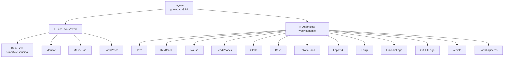
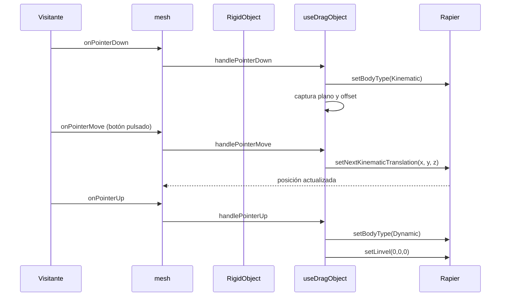

# Sistema de físicas

> Inicio > 04 — Escena 3D > Sistema de físicas

Cómo funciona el sistema de simulación física con `@react-three/rapier`, qué objetos son fijos, cuáles son dinámicos, y cómo añadir nuevos.

## Visión general

El proyecto usa **Rapier** como motor de físicas, expuesto vía `@react-three/rapier`. La simulación:

- Gravedad: `-9.81` en el eje Y (igual que la Tierra).
- timeStep: 1/60s (gestionado internamente).
- Objetos clasificados en **fijos** (no se mueven) y **dinámicos** (caen, chocan, se pueden arrastrar).



## Componentes clave

#### `<Physics>` de `@react-three/rapier`

En este proyecto **no hay un wrapper propio**: el componente `<Physics>` se importa directamente desde `@react-three/rapier` y se monta dentro de un `React.lazy` (ver `App.tsx`) para que su WASM se cargue bajo demanda.

```tsx
<Physics gravity={[0, -9.81, 0]}>
  {/* children */}
</Physics>
```

Acepta `paused` opcional.

#### `RigidObject.tsx`

Componente reutilizable que:

1. Envuelve el modelo en un `<RigidBody>` con `type`, `colliders`, `position`, `rotation`, `scale`.
2. Si es dinámico y `draggable={true}`, monta los handlers de `useDragObject` en un `<group>` hijo.

```tsx
interface RigidObjectProps {
  type?: 'fixed' | 'dynamic';
  colliders?: 'cuboid' | 'hull' | 'ball';
  position?: [number, number, number];
  rotation?: [number, number, number];
  scale?: number | [number, number, number];
  draggable?: boolean;
  children: ReactNode;
}
```

#### `useDragObject.ts` (hook)

Implementa el drag físico. Ver sección [Drag con el ratón](#drag-con-el-ratón).

## Clasificación de los 17 modelos

### Fijos (`type="fixed"`)

Son superficies o anclas que no deben moverse:

| Modelo | Posición | Razón |
|---|---|---|
| `DeskTable` | `(0, -0.5, 0)` | Superficie sobre la que reposan los demás. |
| `Monitor` | `(0, 1.43, -0.48)` | Anclado al escritorio. |
| `MausePad` | `(0.15, 1.485, 0.35)` | Anclado al escritorio. |
| `PortaVasos` | `(-2.2, 1.485, 0.57)` | Anclado al escritorio. |

### Dinámicos (`type="dynamic"`)

Son objetos que caen con gravedad y pueden ser arrastrados:

| Modelo | Posición |
|---|---|
| `Taza` | `(-2.2, 1.48, 0.56)` |
| `PortaLapiceros` | `(-2, 1.48, -0.4)` |
| `KeyBoard` | `(0, 1.55, 0.38)` |
| `Mause` | `(0.9, 1.48, 0.38)` |
| `RoboticHand` | `(-1.4, 1.48, -0.5)` |
| `HeadPhones` | `(1.5, 1.57, 0.4)` |
| `Band` | `(-1.4, 1.535, 0.4)` |
| `Clock` | `(0.7, 1.476, -0.3)` |
| `Lamp` | `(2, 1.47, -0.3)` |
| `LinkedinLogo` | `(1.4, 1.49, -0.3)` |
| `GitHubLogo` | `(1.65, 1.49, -0.3)` |
| `Vehicle` | `(-2, 1.49, 0.2)` |
| `Lapiz` (×4) | Distintas posiciones |

## Tipos de colisionadores

| Tipo | Uso | Ventaja | Desventaja |
|---|---|---|---|
| `cuboid` | **Por defecto en este proyecto.** Todos los modelos. | Muy rápido, suficiente para casi todos los casos, robusto con modelos de muchas mallas. | Impreciso para formas muy irregulares. |
| `hull` | (No usado en este proyecto). | Forma envolvente fiel a la geometría. | Más lento y potencialmente inestable cuando hay muchas mallas. |
| `ball` | (No usado). | Rápido para esferas. | Sólo para esferas perfectas. |

En este proyecto se usa **`cuboid` para todos los modelos**. La caja envolvente del conjunto es suficiente para que los objetos reposen correctamente sobre el escritorio y choquen entre sí. Cuando el `RigidBody` envuelve muchas mallas (como el teclado con 102 teclas), `cuboid` da un comportamiento predecible, mientras que `hull` puede ser problemático porque rapier intenta combinar todas las geometrías en un único hull.

## Drag con el ratón

El hook `useDragObject` permite arrastrar cualquier `RigidObject` dinámico.

### Flujo del drag



### Implementación por dentro

1. **`pointerDown`**: al pulsar, el hook sube por el árbol de three.js hasta encontrar el `Object3D` del `<RigidBody>` (lo marca `@react-three/rapier` con `userData.rigidBody`). Captura:
   - La posición del RigidBody en ese momento.
   - El plano perpendicular a la cámara que pasa por esa posición.
   - El offset entre el punto exacto del click y el centro del RigidBody.

2. **Cambio a kinematic**: `setBodyType(2, true)` convierte el RigidBody en `KinematicPositionBased`, lo que permite moverlo por código sin que las colisiones lo empujen.

3. **`pointerMove`**: proyecta el ratón sobre el plano y aplica `setNextKinematicTranslation`.

4. **`pointerUp`**: restaura el RigidBody a `dynamic` (`setBodyType(0, true)`) y anula las velocidades (`setLinvel(0,0,0)`, `setAngvel(0,0,0)`). **No hay lanzamiento**: el objeto reposa donde lo dejaste.

### Cursor

El hook cambia el cursor del `<canvas>` a:
- `grab` cuando se está arrastrando (`pointerDown`).
- `grabbing` mientras se arrastra (`pointerMove` con botón pulsado).
- `default` cuando se suelta.

Para que el cursor cambie también al pasar sobre un objeto arrastrable, añadir `style={{ cursor: 'grab' }}` en el `<mesh>`.

## Cómo añadir un nuevo objeto físico

### 1. Crear el componente (siguiendo el patrón)

```tsx
// src/components/3d-models/MiObjeto.tsx
import type { Mesh } from 'three';
import { useGLTF } from '@react-three/drei';
import RigidObject from '../physics/RigidObject';

export default function Model() {
  const { nodes, materials } = useGLTF('/3d-models/mi-objeto.glb');

  return (
    <RigidObject type="dynamic" colliders="hull" position={[0, 1.5, 0]} scale={1}>
      <mesh
        castShadow
        receiveShadow
        geometry={(nodes.miObjeto as Mesh).geometry}
        material={materials.miObjeto}
      />
    </RigidObject>
  );
}

useGLTF.preload('/3d-models/mi-objeto.glb');
```

### 2. Registrar en `App.tsx` dentro de `<Physics>`

```tsx
import MiObjeto from './components/3d-models/MiObjeto';

// …
<Physics>
  {/* ... */}
  <MiObjeto />
</Physics>
```

### 3. Decidir fijo o dinámico

| Caso | type |
|---|---|
| Es superficie, anclaje o decoración pesada | `fixed` |
| Es un objeto que debe caer, chocar o arrastrarse | `dynamic` |

## Cómo añadir un objeto fijo sin físicas

Para elementos puramente visuales (suelo, paredes, decoraciones), no hace falta `<RigidBody>`:

```tsx
<mesh receiveShadow position={[0, -0.51, 0]}>
  <boxGeometry args={[20, 0.02, 20]} />
  <meshStandardMaterial color="#c8a878" />
</mesh>
```

Es el patrón usado en `Room.tsx`, `Plant.tsx` y `WallDecor.tsx`.

## Limitaciones

- ❌ **No hay lanzamiento con velocidad**: al soltar, el objeto reposa. Implementable en el futuro modificando `handlePointerUp` para calcular velocidad desde el historial de posiciones.
- ❌ **Drag sólo en plano perpendicular a la cámara**: no se puede "rotar" el objeto en el aire.
- ❌ **No hay callback de colisión**: no se ejecuta código cuando un objeto colisiona con otro.

## Documentos relacionados

- [Sistema de escena](./sistema-de-escena.md)
- [Sistema de luces](./sistema-de-luces.md)
- [Cómo añadir un modelo 3D](../03-componentes/como-anadir-modelo-3d.md)
- [Cómo crear un componente reutilizable](../03-componentes/como-crear-componente-reutilizable.md)