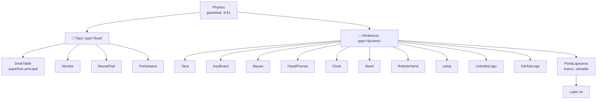
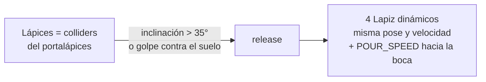

# Sistema de físicas

> Inicio > 04 — Escena 3D > Sistema de físicas

Cómo funciona el sistema de simulación física con `@react-three/rapier`, qué objetos son fijos, cuáles son dinámicos, y cómo añadir nuevos.

## Visión general

El proyecto usa **Rapier** como motor de físicas, expuesto vía `@react-three/rapier`. La simulación:

- Gravedad: `-9.81` en el eje Y (igual que la Tierra).
- timeStep: 1/60s (gestionado internamente).
- Objetos clasificados en **fijos** (no se mueven) y **dinámicos** (caen, chocan y el personaje puede empujarlos).



## Componentes clave

#### `<Physics>` de `@react-three/rapier`

En este proyecto **no hay un wrapper propio**: el componente `<Physics>` se importa directamente desde `@react-three/rapier` y se monta dentro de un `React.lazy` (ver `App.tsx`) para que su WASM se cargue bajo demanda.

```tsx
<Physics gravity={[0, -9.81, 0]}>
  {/* children */}
</Physics>
```

Acepta `paused` opcional.

#### `RigidObject.tsx`

Componente reutilizable que:

1. Envuelve el modelo en un `<RigidBody>` con `type`, `colliders`, `position`, `rotation`, `scale`.
2. Si es dinámico y tiene `sound` u `onFloorImpact`, detecta los golpes contra el suelo con `useFloorImpact` (ver [Sistema de sonido](./sistema-de-sonido.md)).

```tsx
interface RigidObjectProps {
  type?: 'fixed' | 'dynamic';
  colliders?: 'cuboid' | 'hull' | 'ball' | false; // false = colliders hijos
  position?: [number, number, number];
  rotation?: [number, number, number];
  scale?: number | [number, number, number];
  ccd?: boolean;
  density?: number;          // densidad de los colliders automáticos (defecto 1)
  knock?: number;            // vuelco al chocar el personaje
  sound?: SoundMaterial;
  onFloorImpact?: (impact: FloorImpact) => void;
  children: ReactNode;
}
```

## Clasificación de los 17 modelos

### Fijos (`type="fixed"`)

Son superficies o anclas que no deben moverse:

| Modelo | Posición | Razón |
|---|---|---|
| `DeskTable` | `(0, -0.5, 0)` | Superficie sobre la que reposan los demás. |
| `Monitor` | `(0, 1.43, -0.48)` | Anclado al escritorio. |
| `MausePad` | `(0.15, 1.485, 0.35)` | Anclado al escritorio. |
| `PortaVasos` | `(-2.2, 1.485, 0.57)` | Anclado al escritorio. |

### Dinámicos (`type="dynamic"`)

Son objetos que caen con gravedad y el personaje puede empujar:

| Modelo | Posición |
|---|---|
| `Taza` | `(-2.2, 1.48, 0.56)` |
| `PortaLapiceros` | `(-2, 1.48, -0.4)` |
| `KeyBoard` | `(0, 1.55, 0.38)` — `density={BULKY_DENSITY}`: el coche no lo mueve |
| `Mause` | `(0.9, 1.48, 0.38)` |
| `RoboticHand` | `(-1.4, 1.48, -0.5)` — `density={BULKY_DENSITY}`: el coche no lo mueve |
| `HeadPhones` | `(1.5, 1.57, 0.4)` — `density={BULKY_DENSITY}`: el coche no lo mueve |
| `Band` | `(-1.4, 1.535, 0.4)` |
| `Clock` | `(0.7, 1.476, -0.3)` |
| `Lamp` | `(2, 1.47, -0.3)` — `density={BULKY_DENSITY}`: el coche no lo mueve |
| `LinkedinLogo` | `(1.4, 1.49, -0.3)` |
| `GitHubLogo` | `(1.65, 1.49, -0.3)` |
| `Lapiz` (×4) | Dentro del portalápices (los monta `PortaLapiceros`) |

## Tipos de colisionadores

| Tipo | Uso | Ventaja | Desventaja |
|---|---|---|---|
| `cuboid` | **Por defecto en este proyecto.** Todos los modelos. | Muy rápido, suficiente para casi todos los casos, robusto con modelos de muchas mallas. | Impreciso para formas muy irregulares. |
| `hull` | (No usado). | Forma envolvente fiel a la geometría. | Más lento y potencialmente inestable cuando hay muchas mallas. |
| `ball` | (No usado). | Rápido para esferas. | Sólo para esferas perfectas. |

En este proyecto se usa **`cuboid` para casi todos los modelos**; la excepción es el portalápices, que usa un collider compuesto hueco (ver más abajo). Ojo: `@react-three/rapier` crea **una caja por malla**, no una para todo el modelo (el teclado es una placa más una caja por tecla; el monitor, base, cuello y pantalla). Estas cajas son suficientes para que los objetos reposen correctamente sobre el escritorio y choquen entre sí. Cuando el `RigidBody` envuelve muchas mallas (como el teclado con 102 teclas), `cuboid` da un comportamiento predecible, mientras que `hull` puede ser problemático porque rapier intenta combinar todas las geometrías en un único hull.

## Arranque de la simulación

`App.tsx` monta `<Physics paused>` y la reanuda tras `WARMUP_FRAMES` (5) fotogramas (`PhysicsStage` + `PhysicsWarmup`). Motivo:

- `@react-three/rapier` crea los colliders **automáticos** (`colliders="cuboid"`, como el del escritorio) uno o varios renders después de montar el cuerpo. Los **manuales** (portalápices, personaje) existen desde el principio.
- Si el primer fotograma tras la carga es lento (compilación de shaders), Rapier recupera hasta 0,5 s de simulación de golpe (30 pasos).

Sin la pausa, los objetos caen antes de que exista el escritorio: los macizos se hunden y salen disparados al aparecer, y los finos (las paredes del portalápices) lo atraviesan.

## Colliders compuestos: el portalápices

Un collider automático `cuboid` es una **caja maciza**, así que no puede contener nada. El portalápices usa `colliders={false}` y construye su forma con colliders hijos, **ajustados a la malla** (una rejilla con la pared entre r ≈ 0,1265 y 0,1433):

- **Fondo**: `CylinderCollider` fino, con el radio exterior (0,141) y fricción alta (`3`). Es el borde sobre el que pivota al volcar, así que vuelca en lugar de resbalar.
- **Pared**: 16 `CuboidCollider` en anillo, exterior en 0,141 e interior en 0,110 (3,1 cm de grosor), con fricción `1`.
  - **Por fuera coincide con la malla.** Si sobresale (antes llegaba a 0,148, y a ~0,16 en las esquinas de un octógono), el portalápices tumbado y lo que se apoya en él **levitan**. Con 16 segmentos las esquinas apenas sobresalen.
  - **Por dentro es más gruesa que la rejilla y que el lápiz** (2,7 cm de diámetro). Con una pared más fina que el lápiz, al quedar uno aplastado (p. ej. con el portalápices tumbado encima), Rapier lo resolvía empujándolo **a través** de la pared. Medido: penetraciones de hasta 2 cm con la pared ajustada a la rejilla, incluso con más iteraciones del solver.
- **CCD** en el portalápices y en los lápices. En Rapier el CCD solo evita el *tunneling* del cuerpo que lo tiene: sin él en el portalápices, al recibir el golpe sus paredes giraban tan rápido que barrían los lápices en un solo paso.
- **`additionalSolverIterations={4}`** en ambos (`PENCIL_SOLVER_ITERATIONS`), para los contactos apretados entre lápiz y pared, sin encarecer el resto de la escena.

### Lápices pegados hasta que vuelca

Mientras el portalápices está de pie, sus 4 lápices **forman parte de su cuerpo rígido**: sus cápsulas son colliders del propio portalápices y no hay contactos lápiz-pared que resolver. Así es imposible que se incrusten. Además, si el personaje empuja los lápices que asoman, empuja el portalápices, como en la realidad.



- **Velocidad al soltarse**: la del punto del portalápices, `v_cm + ω × (p − cm)` (`worldCom()`), más `POUR_SPEED` (0,4 m/s) a lo largo de su eje, hacia la boca.
- **Por qué el empujón**: con el portalápices tumbado nada empuja los lápices a lo largo del tubo. Se quedaban dentro, apoyados en la cara interior (más gruesa que la rejilla) y parecían levitar.
- **Sin vuelta atrás**: una vez liberados no vuelven a meterse.

**Lápices**:
- **Collider**: `CapsuleCollider` con fricción `0`. Redondos, ruedan y resbalan; como cajas se encajaban por las esquinas. Rapier promedia las fricciones, así que lápiz contra pared queda en 0,5.
- **Escala**: las medidas están en `lapizShape.ts`, **ya escaladas** (0,9). `@react-three/rapier` multiplica la posición de un collider anidado por la escala de su padre, que ya va incluida en su matriz, y la aplicaría dos veces. Por eso solo se escala el grupo de las mallas (`LapizVisual`).

**Comportamiento medido** (empujando caminando):
- **Hacia la izquierda**: vuelca y queda tumbado en la mesa. Los lápices salen por la boca y, como el borde está a ~30 cm, caen al suelo.
- **Desde delante**: vuelca y cae por el borde trasero, a 37 cm.
- **Hacia la derecha**: se inclina ~9° y vuelve. Las puntas de los lápices chocan con la caja de colisión de la mano robótica, que envuelve el pulgar extendido.

> ⚠️ `RigidObject` solo pasa a `<RigidBody>` las opciones opcionales (`ccd`, `quaternion`, velocidades, iteraciones) cuando están definidas. `@react-three/rapier` aplica cualquier opción presente en las props aunque valga `undefined`, y algunas (p. ej. `setAngularDamping(undefined)`) hacen fallar la WASM de Rapier.

## Volcar objetos con el personaje (`knock`)

El personaje es bajo (radio 0,09) y se controla por velocidad: empuja casi a ras de la base. Con el contacto físico solo, un objeto alto y ligero como el portalápices **resbala** en lugar de volcar. Por eso los objetos pueden declarar `knock` en `RigidObject`:

```tsx
<RigidObject type="dynamic" colliders={false} knock={0.003}>…</RigidObject>
```

`usePlayerKnock` aplica entonces, al chocar el personaje, un **impulso de giro** que vuelca el objeto en la dirección del golpe:

- **Fuerza**: `knock × velocidad`, con la velocidad limitada a 1,5 m/s; si no, al correr el objeto sale despedido.
- **Velocidad usada**: la que el personaje **intenta** llevar (`userData.vx/vz`, ver `PlayerUserData`), porque tras el choque su velocidad real ya está frenada.
- **Solo de pie**: el impulso se aplica si el objeto está casi vertical (< 25°) y con 300 ms de enfriamiento. Una vez volcado, basta el contacto normal.

Valor del portalápices: `0,003`. Con `0,002` no llega a volcar; con valores mayores sale despedido de la mesa.

El portalápices también expone su cuerpo con `bodyRef` (prop de `RigidObject`) para leer su inclinación y soltar los lápices.

## Interacción

El visitante **no manipula los objetos con el ratón** (la cámara es fija). La única forma de mover los objetos dinámicos es empujarlos con el personaje, que es un cuerpo dinámico más y choca con ellos a través de Rapier. Ahora es el coche (`DrivableVehicle`, ver [Sistema de vehículo](./sistema-de-vehiculo.md)); el gato (`Player`) está en el repo sin montar.

Los objetos voluminosos (teclado, lámpara, mano robótica, auriculares) llevan `density={BULKY_DENSITY}` (`physics/density.ts`): pesan tanto que el coche choca con ellos y se detiene, mientras que los ligeros los sigue empujando.

## Cómo añadir un nuevo objeto físico

### 1. Crear el componente (siguiendo el patrón)

```tsx
// src/components/3d-models/MiObjeto.tsx
import type { Mesh } from 'three';
import { useGLTF } from '@react-three/drei';
import RigidObject from '../physics/RigidObject';

export default function Model() {
  const { nodes, materials } = useGLTF('/3d-models/mi-objeto.glb');

  return (
    <RigidObject type="dynamic" colliders="hull" position={[0, 1.5, 0]} scale={1}>
      <mesh
        castShadow
        receiveShadow
        geometry={(nodes.miObjeto as Mesh).geometry}
        material={materials.miObjeto}
      />
    </RigidObject>
  );
}

useGLTF.preload('/3d-models/mi-objeto.glb');
```

### 2. Registrar en `App.tsx` dentro de `<Physics>`

```tsx
import MiObjeto from './components/3d-models/MiObjeto';

// …
<Physics>
  {/* ... */}
  <MiObjeto />
</Physics>
```

### 3. Decidir fijo o dinámico

| Caso | type |
|---|---|
| Es superficie, anclaje o decoración pesada | `fixed` |
| Es un objeto que debe caer, chocar o ser empujado | `dynamic` |

## Cómo añadir un objeto fijo sin físicas

Para elementos puramente visuales (suelo, paredes, decoraciones), no hace falta `<RigidBody>`:

```tsx
<mesh receiveShadow position={[0, -0.51, 0]}>
  <boxGeometry args={[20, 0.02, 20]} />
  <meshStandardMaterial color="#c8a878" />
</mesh>
```

Es el patrón usado en `Room.tsx`, `Plant.tsx` y `WallDecor.tsx`.

## Limitaciones

- ⚠️ **Sólo se detectan golpes contra el suelo** (`useFloorImpact`); los choques entre objetos no suenan.

## Documentos relacionados

- [Sistema de escena](./sistema-de-escena.md)
- [Sistema de luces](./sistema-de-luces.md)
- [Cómo añadir un modelo 3D](../03-componentes/como-anadir-modelo-3d.md)
- [Cómo crear un componente reutilizable](../03-componentes/como-crear-componente-reutilizable.md)