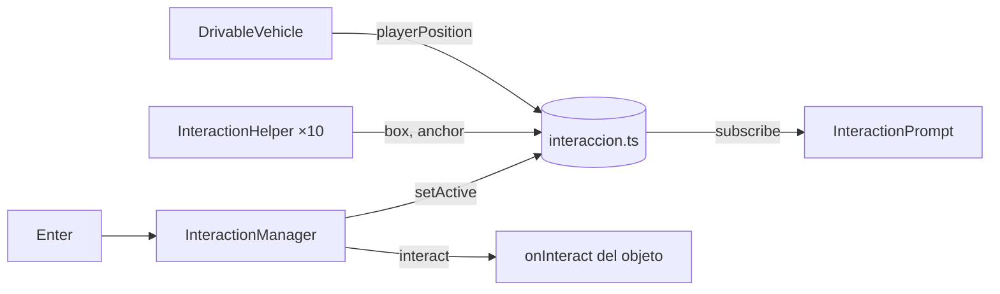

# Sistema de interacción

> Inicio > 04 — Escena 3D > Sistema de interacción

Los objetos del escritorio (salvo el monitor, el teclado, la alfombrilla y el portavasos) tienen un **orbe de luz** que orbita sobre ellos. Cuando el vehículo se acerca, el orbe brilla más, aparece el aviso **"Enter · Interactuar con X"** y, al pulsar Enter, se ejecuta la acción del objeto.

> Las acciones concretas aún no están definidas: por ahora Enter solo hace destellar el orbe y escribe en la consola `"[interacción] "Taza" aún no tiene acción."`.

## Piezas

| Archivo | Qué hace |
|---|---|
| `src/helpers/interaccion.ts` | Store plano (sin React): registro de objetos, objeto activo, `playerPosition`, `interact()`. |
| `src/components/interaction/InteractionHelper.tsx` | El orbe de un objeto. Mide cada fotograma la caja en mundo de sus mallas y orbita sobre su punto más alto. |
| `src/components/interaction/InteractionManager.tsx` | Dentro del `<Canvas>`: elige el objeto más cercano al vehículo, escucha Enter y mueve la única `pointLight`. |
| `src/components/interaction/InteractionPrompt.tsx` | Overlay HTML abajo al centro con el aviso (fuera del `<Canvas>`). |
| `src/components/physics/RigidObject.tsx` | Prop `interactable={{ id, label, onInteract? }}`. |
| `src/components/player/DrivableVehicle.tsx` | Copia su posición en `playerPosition` antes de cada paso de física. |



## Detalles

- **El orbe va fuera del `RigidBody`**, como hermano. Dentro, `@react-three/rapier` le crearía un collider automático y además giraría con el objeto. `RigidObject` envuelve sus hijos en un `<group>` sin transformación para que el helper pueda medir las mallas.
- **Sigue al objeto aunque lo empujen o vuelque**, porque usa la caja envolvente en mundo, recalculada cada fotograma.
- **Sin luces por objeto**: el orbe es un material básico aditivo (núcleo + halo). Solo hay una `pointLight`, en `InteractionManager`, que acompaña al orbe activo y se apaga (intensidad 0) si no hay ninguno. Montar y desmontar luces obligaría a three.js a recompilar todos los materiales.
- **Cercanía**: distancia horizontal del centro del vehículo a la caja del objeto < `NEAR_DISTANCE` (0,3). Se suelta con un margen extra (`RELEASE_MARGIN`) para que no parpadee en el borde.
- **Enter** se ignora si el foco está en un botón o campo de texto.

## Ajustes

| Cambio | Dónde |
|---|---|
| Distancia para interactuar | `NEAR_DISTANCE` en `InteractionManager.tsx` |
| Brillo de la luz del objeto activo | `LIGHT_INTENSITY` en `InteractionManager.tsx` |
| Altura, radio y velocidad de la órbita | constantes al inicio de `InteractionHelper.tsx` |
| Opacidad en reposo / activo | `IDLE_OPACITY`, `ACTIVE_OPACITY` |
| Color | `coloresUI.accent` (`amarillos[500]`) |

## Añadir una acción a un objeto

```tsx
<RigidObject
  interactable={{
    id: 'reloj',
    label: 'Reloj',
    onInteract: () => { /* … */ },
  }}
  …
>
```

## Documentos relacionados

- [Sistema de vehículo](./sistema-de-vehiculo.md)
- [Sistema de físicas](./sistema-de-fisicas.md)
- [Sistema de colores](../05-estilos/sistema-de-colores.md)
