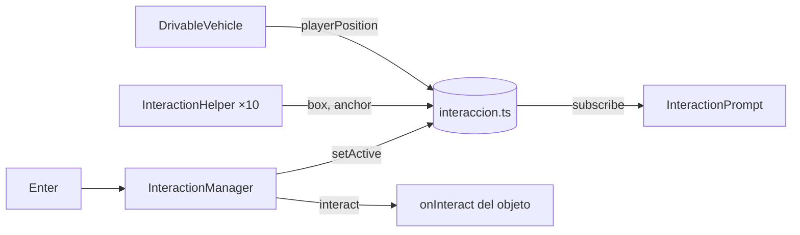

# Sistema de interacción

> Inicio > 04 — Escena 3D > Sistema de interacción

Los objetos del escritorio (salvo el monitor, el teclado, la alfombrilla y el portavasos) tienen un **orbe de luz** que orbita sobre ellos. Cuando el vehículo se acerca, el orbe brilla más, aparece el aviso **"Enter · Interactuar con X"** y, al pulsar Enter, se ejecuta la acción del objeto.

> Acciones definidas:
> - **Ratón** → acerca la cámara al monitor, que se enciende y muestra el perfil (ver [Pantalla del monitor](#pantalla-del-monitor)).
> - **LinkedIn** y **GitHub** → abren `perfil.redes.linkedin` / `perfil.redes.github` (`src/data/perfil.ts`) en una pestaña nueva con `abrirEnlace` (`src/helpers/abrirEnlace.ts`). Por ahora apuntan a la home de cada red; basta con cambiar esas dos URL por los perfiles reales.
>
> El resto todavía no tiene acción: Enter hace destellar el orbe y escribe en la consola `"[interacción] "Taza" aún no tiene acción."`.

## Piezas

| Archivo | Qué hace |
|---|---|
| `src/helpers/interaccion.ts` | Store plano (sin React): registro de objetos, objeto activo, `playerPosition`, `interact()`. |
| `src/components/interaction/InteractionHelper.tsx` | El orbe de un objeto. Mide cada fotograma la caja en mundo de sus mallas y orbita sobre su punto más alto. |
| `src/components/interaction/InteractionManager.tsx` | Dentro del `<Canvas>`: elige el objeto más cercano al vehículo, escucha Enter y mueve la única `pointLight`. |
| `src/components/interaction/InteractionPrompt.tsx` | Overlay HTML abajo al centro con el aviso (fuera del `<Canvas>`). |
| `src/components/physics/RigidObject.tsx` | Prop `interactable={{ id, label, onInteract? }}`. |
| `src/components/player/DrivableVehicle.tsx` | Copia su posición en `playerPosition` antes de cada paso de física. |



## Detalles

- **El orbe va fuera del `RigidBody`**, como hermano. Dentro, `@react-three/rapier` le crearía un collider automático y además giraría con el objeto. `RigidObject` envuelve sus hijos en un `<group>` sin transformación para que el helper pueda medir las mallas.
- **Sigue al objeto aunque lo empujen o vuelque**, porque usa la caja envolvente en mundo, recalculada cada fotograma.
- **Sin luces por objeto**: el orbe es un material básico aditivo (núcleo + halo). Solo hay una `pointLight`, en `InteractionManager`, que acompaña al orbe activo y se apaga (intensidad 0) si no hay ninguno. Montar y desmontar luces obligaría a three.js a recompilar todos los materiales.
- **Cercanía**: distancia horizontal del centro del vehículo a la caja del objeto < `NEAR_DISTANCE` (0,3). Se suelta con un margen extra (`RELEASE_MARGIN`) para que no parpadee en el borde.
- **Enter** se ignora si el foco está en un botón o campo de texto.

## Ajustes

| Cambio | Dónde |
|---|---|
| Distancia para interactuar | `NEAR_DISTANCE` en `InteractionManager.tsx` |
| Brillo de la luz del objeto activo | `LIGHT_INTENSITY` en `InteractionManager.tsx` |
| Altura, radio y velocidad de la órbita | constantes al inicio de `InteractionHelper.tsx` |
| Opacidad en reposo / activo | `IDLE_OPACITY`, `ACTIVE_OPACITY` |
| Color | `coloresUI.accent` (`amarillos[500]`) |

## Añadir una acción a un objeto

```tsx
<RigidObject
  interactable={{
    id: 'reloj',
    label: 'Reloj',
    onInteract: () => { /* … */ },
  }}
  …
>
```

## Pantalla del monitor

Enter junto al ratón llama a `setFocus('monitor')` (`src/helpers/vista.ts`). La pantalla tiene tres estados:

| Estado | Cuándo | Qué se ve |
|---|---|---|
| `off` | Vista de escena | Pantalla apagada: casi negra con un reflejo suave. |
| `booting` | Desde que empieza el zoom, durante `BOOT_MS` (2 s, nunca menos que el zoom de 1,2 s) | `BootScreen`: logo "3D", "Encendiendo…" y una barra que se llena en esos 2 s (animación CSS). |
| `on` | Al terminar el arranque | El perfil (`PerfilPanel`) con un fundido; botones y Esc activos. |

Al volver a la escena (✕, "Volver a la escena" o Esc) la pantalla se apaga al instante. Cada encendido reinicia el arranque.

| Pieza | Qué hace |
|---|---|
| `helpers/vista.ts` | Store del foco de la cámara (`'scene'` / `'monitor'`) y `CAMERA_TRANSITION_SECONDS`. |
| `helpers/monitor.ts` | Pose del monitor y plano de la pantalla medido en `monitor.glb` (`SCREEN`: 2,03 × 1,04, mira a +X local); `screenWorld()` da su centro y normal en mundo. |
| `scene-environment/Controls.tsx` | Lleva la cámara de la vista fija a quedar de frente a la pantalla en 1,2 s (`smootherstep`). La distancia se calcula para que la pantalla quepa entera con el FOV y el aspecto actuales (+8 % de margen), y se recalcula si cambia el tamaño de la ventana. |
| `monitor/MonitorScreen.tsx` | Hermano del RigidObject del monitor (con su misma pose). Monta la pantalla como `<Html transform occlude="blending">` de drei y decide el estado (`off` / `booting` / `on`). Con el perfil visible: activa los clics y Esc cierra. |
| `monitor/BootScreen.tsx` | Pantalla de arranque ("Encendiendo…" + barra). |
| `monitor/PerfilPanel.tsx` | El panel "Sobre mí" del wireframe (1040 × 533 px, el aspecto de la pantalla) con `coloresUI`. |
| `data/perfil.ts` | Datos **provisionales** (John Doe…). El CV se enlaza al rellenar `cv`. |

**Cómo se ajusta el panel a la pantalla.** Con `transform`, drei convierte 1 px CSS en `distanceFactor / 400` unidades, así que `distanceFactor = 2,03 × 400 / 1040` hace que el panel mida lo mismo que la malla.

**Nitidez.** El navegador rasteriza el HTML a su tamaño CSS y luego lo transforma. Con 1040 px y la cámara acercada en una pantalla QHD (~2400 px de panel), la imagen se **ampliaba** y se veía borrosa. Por eso `MonitorScreen` amplía el panel con CSS `zoom` (`resolutionFor`: el ancho con el que se verá de cerca ÷ 1040, en cuartos, máximo 3,5) y divide `distanceFactor` por lo mismo. En la escena mide igual, pero de cerca el navegador **reduce** en vez de ampliar. Medido a 2560 × 1440: `zoom` 2,5 → 2600 px rasterizados, mostrados a 2370 px.

**Oclusión (`occlude="blending"`).** La pantalla (apagada o encendida) siempre está en la escena, así que un objeto 3D que pase por delante del monitor debe taparla. En este modo, drei pone el HTML **detrás** del `<Canvas>` y dibuja una malla transparente en su sitio; lo que esté delante se pinta encima con normalidad.
- **Clics:** drei pone `pointer-events: none` en el canvas (la escena no usa eventos de puntero de R3F), y el panel solo acepta clics en el estado `on`.
- **Collider:** esa malla es el motivo de que `MonitorScreen` no vaya dentro del RigidObject, porque generaría un collider.
- **Apilamiento:** `zIndexRange={[100, 0]}` y `isolation: isolate` en `#canvas-container` (`index.css`) evitan que el canvas o el panel queden por encima del Loader y de los overlays.

**Mientras se mira el monitor**:
- el vehículo ignora el teclado (`NO_KEYS` en `DrivableVehicle`);
- Enter no interactúa y no hay objeto activo;
- se ocultan el panel de controles y el aviso;
- ✕, "Volver a la escena" o Esc devuelven la cámara.

**Sin bordes blancos.** El HTML (CSS3D) y el hueco que drei abre en el canvas (WebGL) redondean sus bordes de forma distinta. Por las franjas sub-píxel entre ambos asomaba el fondo **blanco** de la página. Dos arreglos:
- **Hueco más pequeño:** el hueco es una `geometry` propia de `SCREEN × HOLE_INSET` (0,994), un poco más pequeña que el HTML. El borde del HTML queda tapado por la malla de la pantalla. Con `geometry`, drei no reescala la malla.
- **Fondo oscuro de respaldo:** `html`, `body` y `#canvas-container` tienen fondo `#0b1015` (`index.css`). También cubre la franja superior que la cámara ve por encima de la pared al acercarse al monitor, que antes salía blanca.

Comprobado pintando ese fondo de magenta: alrededor del panel no aparece ningún píxel magenta.

**Tamaños de monitor probados** (viewport CSS, con la barra del navegador ya descontada):

| Monitor típico | Viewport | `zoom` | Rasterizado / mostrado (px) | Cabe |
|---|---|---|---|---|
| 18,5" 1366×768 | 1366×650 | 1,25 | 1300 / 1175 | ✅ (lo limita el alto) |
| 21,5"–24" 1920×1080 | 1920×960 | 1,75 | 1820 / 1735 | ✅ |
| 24" 16:10 1920×1200 | 1920×1080 | 1,75 | 1820 / 1778 | ✅ |
| 27" QHD 2560×1440 | 2560×1320 | 2,5 | 2600 / 2370 | ✅ |
| 27" 4K al 100 % | 3840×2040 | 3,5 | 3640 / 3556 | ✅ |

- **Nitidez:** en todos, el panel se rasteriza a un tamaño ≥ al que se muestra, así que el navegador nunca amplía la imagen.
- **Pantallas con escalado** (p. ej. 4K al 150 % → 2560×1320 CSS): el navegador multiplica el rasterizado por el DPR, así que equivalen a la fila de su viewport CSS.
- **Interfaz en 1366×650:** el panel de controles desplegado y el aviso de Enter caben sin solaparse.

**Límites del enfoque (`Html transform`)**:
- El panel es HTML (CSS3D), no una textura: no recibe las luces ni las sombras de la escena.
- Durante el zoom puede verse algo borroso; queda nítido al llegar.
- En pantallas estrechas (móvil en vertical) la pantalla cabe a lo ancho, pero el texto queda muy pequeño. Si importa, habría que mostrar en móvil una versión del panel a pantalla completa.
- Siempre está montado. Apagado usa `zoom: 1` (capa de 1040 × 533 px), y solo con el monitor encendido sube hasta ~3640 × 1866 px en monitores grandes (`MAX_RESOLUTION` = 3,5).

## Enlaces externos y teclas pulsadas

`abrirEnlace(url)` usa `window.open(url, '_blank', 'noopener,noreferrer')`:
- **No lo bloquea el navegador:** se llama dentro del manejador de Enter, que es un gesto del usuario, así que no cuenta como ventana emergente.
- **`noopener,noreferrer`:** la página abierta no puede acceder a esta.

**Teclas pulsadas al cambiar de pestaña.** `KeyboardControls` de drei solo escucha `keydown`/`keyup`. Si se abre otra pestaña con una tecla pulsada (p. ej. manteniendo W), el `keyup` se pierde y al volver el coche seguiría acelerando. `useReleaseKeysOnBlur` (`App.tsx`) envía un `keyup` de cada tecla del mapa cuando la ventana pierde el foco. Comprobado: manteniendo W y simulando el `blur`, el coche frena hasta pararse, mientras que sin `blur` sigue avanzando.

## Documentos relacionados

- [Sistema de vehículo](./sistema-de-vehiculo.md)
- [Sistema de físicas](./sistema-de-fisicas.md)
- [Sistema de colores](../05-estilos/sistema-de-colores.md)
