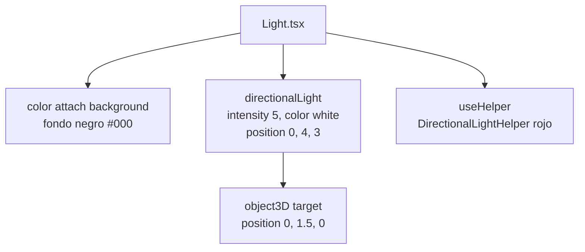
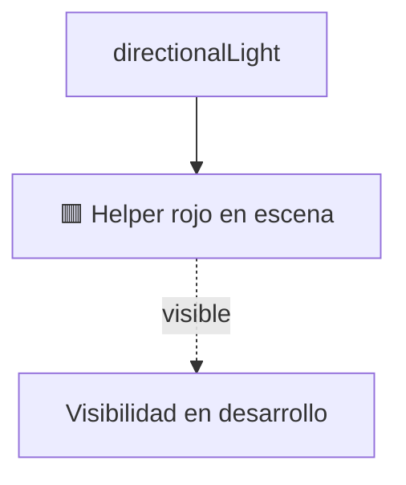
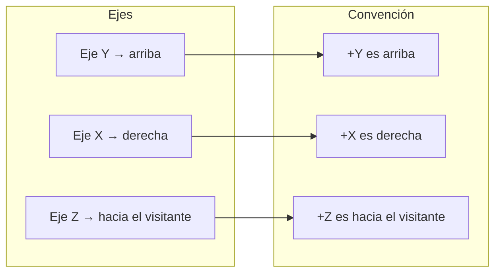

# Sistema de luces

> Inicio > 04 — Escena 3D > Sistema de luces

Cómo está configurada la iluminación de la escena y por qué el estado actual tiene algunos detalles a revisar.

## El componente `Light.tsx`

```tsx
import { useHelper } from '@react-three/drei';
import { DirectionalLightHelper } from "three"
import { useRef } from 'react';

const Light = () => {
  const refLight = useRef<DirectionalLightHelper>(null!);
  
  useHelper(refLight, DirectionalLightHelper, 1, "red");
  
  return (
    <>
        <color attach="background" args={["#000"]} />
        <directionalLight
          ref={refLight}
          intensity={5}
          color="white"
          position={[0, 4, 3]}
        > 
            <object3D attach="target" position={[0, 1.5, 0]} />
        </directionalLight>
    </>
  )
}

export default Light;
```

## Anatomía



### 1. `<color attach="background" args={["#000"]} />`

Establece el color de fondo de la escena a **negro**. Es independiente del `<Sky>` que aparece justo después en `App.tsx`: el `<Sky>` cubre el fondo, pero si no estuviera, verías este negro.

### 2. `<directionalLight>` principal

- **`intensity={5}`** — intensidad alta.
- **`color="white"`** — luz blanca neutra.
- **`position={[0, 4, 3]}`** — la luz está **arriba** (y=4) y ligeramente **detrás** (z=3). Simula un sol cenital con leve componente posterior.

### 3. `<object3D attach="target" position={[0, 1.5, 0]} />`

El **target** define hacia dónde apunta la luz. Por defecto, una `DirectionalLight` apunta al origen `(0,0,0)`, lo que aquí sería el suelo. Apuntando a `(0, 1.5, 0)` dirigimos la luz al centro del escritorio.

Visualmente:

```mermaid
graph LR
    L[💡 Luz en 0, 4, 3] -- dirección -- T[🎯 Target en 0, 1.5, 0]
    T -.ilumina.-> M[Escritorio y modelos]
```

### 4. `useHelper`

```tsx
const refLight = useRef<DirectionalLightHelper>(null!);
useHelper(refLight, DirectionalLightHelper, 1, "red");
```

`useHelper` de `@react-three/drei` añade un **helper visual** a la escena: una línea roja que muestra la dirección y posición de la luz.



⚠️ **Problema:** este helper está siempre activo, incluso en producción. Debería usarse sólo en desarrollo.

## Helpers en los otros componentes

### `Controls.tsx`

```tsx
const refLight = useRef(null);
useHelper(refLight.current, DirectionalLightHelper, 1, "red");
```

⚠️ **Bug menor:** se pasa `refLight.current` en lugar del ref directamente. La primera vez, `current` es `null`, lo que puede causar un warning. Lo correcto sería:

```tsx
const refLight = useRef<DirectionalLightHelper>(null!);
useHelper(refLight, DirectionalLightHelper, 1, "red");
```

Además, este helper es **innecesario** porque el `<OrbitControls>` no necesita iluminación. Probablemente sobró un experimento.

## Sistema de coordenadas del proyecto



La luz está **arriba + detrás** para iluminar desde un ángulo cenital con componente posterior, lo que da sombras interesantes sobre el escritorio.

## Sombras

### Estado actual

- En `Light.tsx` **no se especifica** `castShadow={true}` en la `directionalLight`.
- En `App.tsx`, el `<Canvas>` **no tiene** la prop `shadows`.
- En cada mesh de los modelos: `castShadow` y `receiveShadow` están puestos, pero como no hay sombras en el render, no se nota nada.

Para activarlas:

```tsx
// App.tsx
<Canvas shadows style={{ height: '100vh', width: '100%' }}>
```

```tsx
// Light.tsx
<directionalLight
  ref={refLight}
  intensity={5}
  color="white"
  position={[0, 4, 3]}
  castShadow   // ← añadir
>
```

Y opcionalmente configurar el shadow map:

```tsx
<directionalLight
  ...
  shadow-mapSize-width={1024}
  shadow-mapSize-height={1024}
  shadow-camera-near={0.5}
  shadow-camera-far={20}
  shadow-camera-left={-5}
  shadow-camera-right={5}
  shadow-camera-top={5}
  shadow-camera-bottom={-5}
>
```

## Recomendaciones

1. **Quitar `useHelper` en producción** o, al menos, eliminar el `refLight` de `Light.tsx`.
2. **Corregir el `useHelper` en `Controls.tsx`** (no es necesario ahí).
3. **Decidir si se quieren sombras**: si sí, seguir los pasos de arriba; si no, quitar `castShadow`/`receiveShadow` de los meshes para limpiar el código.

## Documentos relacionados

- [Sistema de escena](./sistema-de-escena.md)
- [Posicionamiento de objetos](./posicionamiento-de-objetos.md)
- [Guía de diseño de componentes](../03-componentes/guia-de-diseno-completo.md)