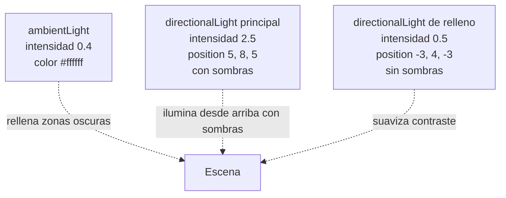
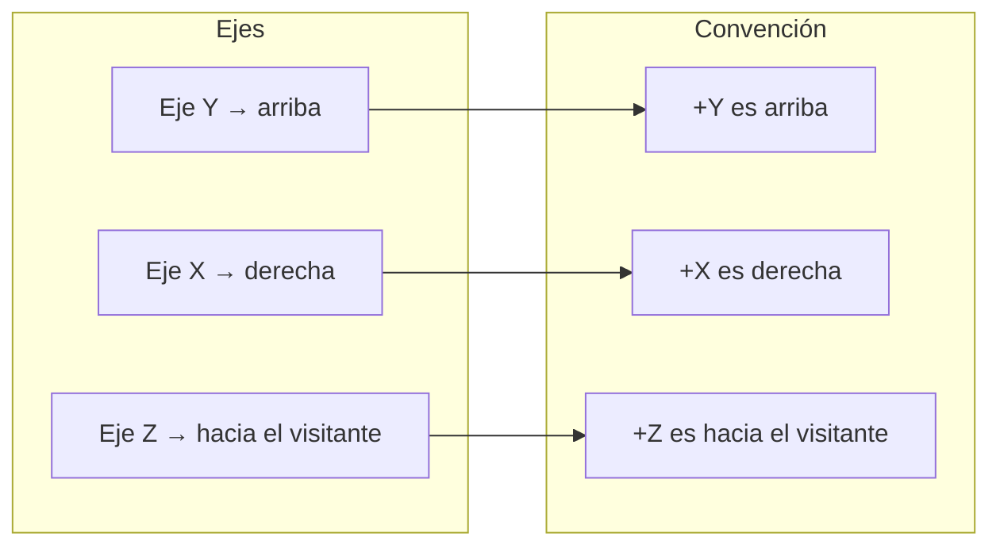

# Sistema de luces

> Inicio > 04 — Escena 3D > Sistema de luces

Cómo está configurada la iluminación y las sombras de la escena.

## El componente `Light.tsx`

```tsx
import { useRef } from 'react';
import type { DirectionalLight } from 'three';

const Light = () => {
  const refLight = useRef<DirectionalLight>(null!);

  return (
    <>
      <ambientLight intensity={0.4} color="#ffffff" />

      <directionalLight
        ref={refLight}
        intensity={2.5}
        color="#ffffff"
        position={[5, 8, 5]}
        castShadow
        shadow-mapSize-width={2048}
        shadow-mapSize-height={2048}
        shadow-camera-left={-8}
        shadow-camera-right={8}
        shadow-camera-top={8}
        shadow-camera-bottom={-8}
        shadow-camera-near={0.5}
        shadow-camera-far={30}
        shadow-bias={-0.0005}
      />

      <directionalLight
        intensity={0.5}
        color="#dde8ff"
        position={[-3, 4, -3]}
      />
    </>
  );
};

export default Light;
```

## Las tres luces



### 1. `ambientLight` (luz ambiental)

- **`intensity={0.4}`** — intensidad baja pero suficiente para evitar negros absolutos.
- **`color="#ffffff"`** — luz neutra.

Suma una cantidad constante de luz a todas las superficies, independientemente de su orientación.

### 2. `directionalLight` principal (con sombras)

- **`intensity={2.5}`** — luz fuerte, la dominante.
- **`position={[5, 8, 5]}`** — cenital con leve desplazamiento hacia la derecha.
- **`castShadow`** — emite sombras.
- **`shadow-mapSize={2048, 2048}`** — mapa de sombras de 2048×2048 píxeles. Da bordes nítidos sin penalizar demasiado el rendimiento.
- **`shadow-camera`** — ortográfica, cubriendo un volumen de `16×16×30` unidades (de `-8` a `+8` en X/Z, de `0.5` a `30` en profundidad). Es lo bastante grande para cubrir toda la habitación.
- **`shadow-bias={-0.0005}`** — pequeño offset para evitar el "shadow acne" (sombras fantasma en superficies).

### 3. `directionalLight` de relleno (sin sombras)

- **`intensity={0.5}`** — luz tenue.
- **`color="#dde8ff"`** — blanco con un toque azulado.
- **`position={[-3, 4, -3]}`** — desde el lado opuesto a la luz principal.

Su función es suavizar el contraste: ilumina ligeramente las zonas que la luz principal deja en sombra.

## Sistema de coordenadas del proyecto



La luz principal está **arriba + derecha-delantera**, lo que da sombras largas hacia la parte trasera-izquierda. Coherente con una lámpara de techo en la esquina de la habitación.

## Sombras

### Estado actual

- ✅ `shadows` activo en `<Canvas>`.
- ✅ Luz direccional principal con `castShadow`.
- ✅ Todos los meshes con `castShadow` y `receiveShadow`.
- ✅ `shadow-mapSize` alta (2048).
- ✅ `shadow-camera` dimensionada para cubrir toda la escena.

Las sombras son **visibles** y nítidas en la escena actual.

## Helpers en los otros componentes

### `Controls.tsx`

✅ **Corregido**: ya no se usa `useHelper` (era innecesario y tenía un bug menor: `refLight.current` se pasaba antes de que el ref estuviera inicializado).

## Recomendaciones de mantenimiento

1. **No añadir `useHelper` en producción**. Si necesitas debug, hazlo condicionalmente con una variable de entorno.
2. **Ajustar `shadow-bias`** si aparecen artefactos ("shadow acne") o "peter panning" (sombras flotantes).
3. **Si la cámara se aleja mucho**, considera aumentar `shadow-camera-far` o reposicionar la luz.

## Documentos relacionados

- [Sistema de escena](./sistema-de-escena.md)
- [Posicionamiento de objetos](./posicionamiento-de-objetos.md)
- [Sistema de físicas](./sistema-de-fisicas.md)