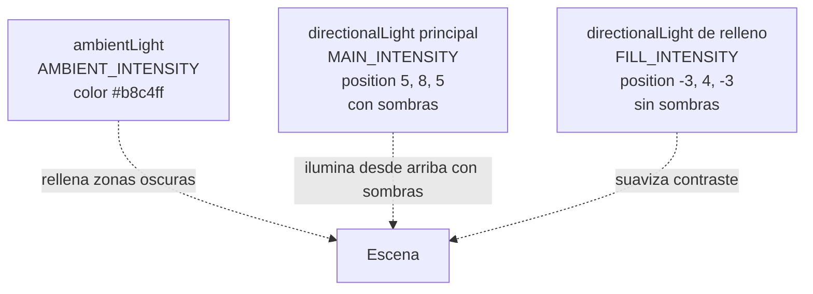
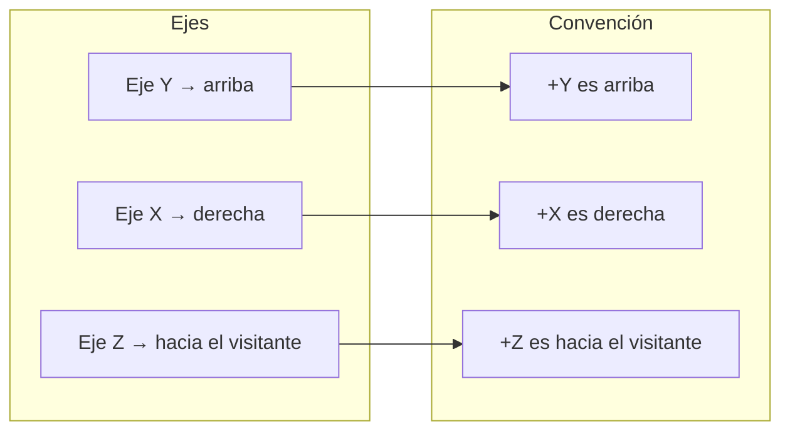

# Sistema de luces

> Inicio > 04 — Escena 3D > Sistema de luces

Cómo está configurada la iluminación y las sombras de la escena.

## El componente `Light.tsx`

La escena es **tenue, de atardecer**: luces frías y poco intensas, para que contrasten las luces del coche (faros, pilotos, direccionales; ver [Sistema de vehículo](./sistema-de-vehiculo.md#luces)) y la bombilla de la lámpara. Las intensidades están en constantes al principio del archivo:

| Constante | Valor | Antes (escena de día) |
|---|---|---|
| `AMBIENT_INTENSITY` | `0.15` | `0.4` |
| `MAIN_INTENSITY` | `0.8` | `2.5` |
| `FILL_INTENSITY` | `0.15` | `0.5` |

Para volver a una escena de día, basta con subirlas (unas 3 veces).

## Las tres luces

### 1. `ambientLight` (luz ambiental)

- **Color `#b8c4ff`** (azulado): da el tono frío de atardecer.
- Suma una cantidad constante de luz a todas las superficies, independientemente de su orientación. Evita los negros absolutos.

### 2. `directionalLight` principal (con sombras)

- **Color `#dfe4ff`**, la dominante.
- **`position={[5, 8, 5]}`**: cenital con leve desplazamiento hacia la derecha.
- **`castShadow`** con un mapa de sombras de 1024×1024.
- **`shadow-camera`**: ortográfica, cubriendo un volumen de `16×16×30` unidades (de `-8` a `+8` en X/Z, de `0.5` a `30` en profundidad). Cubre toda la habitación.
- **`shadow-bias={-0.0005}`**: pequeño offset para evitar el "shadow acne" (sombras fantasma en superficies).

### 3. `directionalLight` de relleno (sin sombras)

- **Color `#c8d4ff`**, desde el lado opuesto (`[-3, 4, -3]`).
- Suaviza el contraste: ilumina un poco las zonas que la luz principal deja en sombra.

## Sistema de coordenadas del proyecto

La luz principal está **arriba + derecha-delantera**, lo que da sombras largas hacia la parte trasera-izquierda. Coherente con una lámpara de techo en la esquina de la habitación.

## Sombras

### Estado actual

- ✅ `shadows` activo en `<Canvas>`.
- ✅ Luz direccional principal con `castShadow`.
- ✅ Todos los meshes con `castShadow` y `receiveShadow`.
- ✅ `shadow-mapSize` alta (2048).
- ✅ `shadow-camera` dimensionada para cubrir toda la escena.

Las sombras son **visibles** y nítidas en la escena actual.

## Helpers en los otros componentes

### `Controls.tsx`

✅ **Corregido**: ya no se usa `useHelper` (era innecesario y tenía un bug menor: `refLight.current` se pasaba antes de que el ref estuviera inicializado).

## Recomendaciones de mantenimiento

1. **No añadir `useHelper` en producción**. Si necesitas debug, hazlo condicionalmente con una variable de entorno.
2. **Ajustar `shadow-bias`** si aparecen artefactos ("shadow acne") o "peter panning" (sombras flotantes).
3. **Si la cámara se aleja mucho**, considera aumentar `shadow-camera-far` o reposicionar la luz.

## Documentos relacionados

- [Sistema de escena](./sistema-de-escena.md)
- [Posicionamiento de objetos](./posicionamiento-de-objetos.md)
- [Sistema de físicas](./sistema-de-fisicas.md)