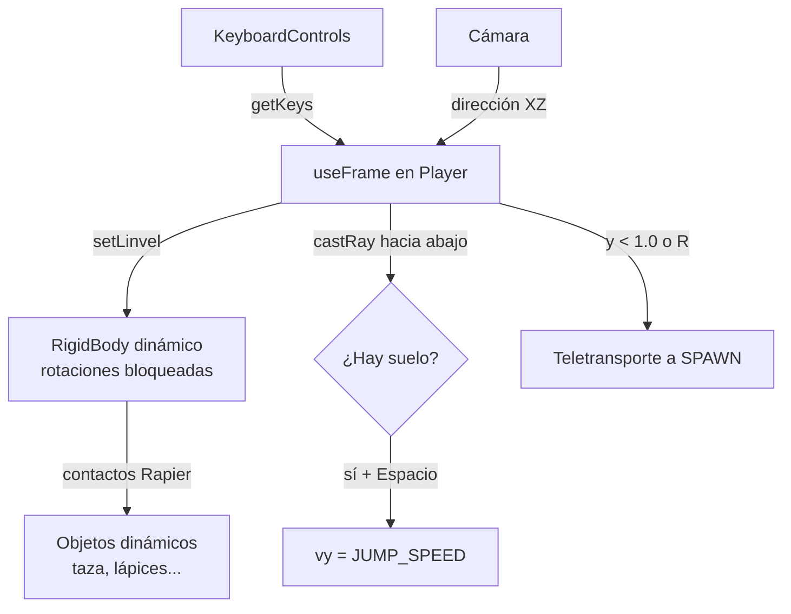

# 🐾 Sistema de personaje

> Personaje controlable con el teclado que recorre el escritorio y empuja los objetos. Hoy es una esfera; está pensado para sustituirse por el modelo del gato.

## Archivos

| Archivo | Rol |
|---|---|
| `src/components/player/keyboardMap.ts` | Acciones (`Controls`), mapa de teclas para `<KeyboardControls>` y etiquetas legibles. |
| `src/components/player/Player.tsx` | Cuerpo físico + lógica de movimiento en `useFrame`. |
| `src/components/scene-environment/ControlsHelp.tsx` | Panel HTML con las instrucciones (se pliega con **H**). |
| `src/App.tsx` | Envuelve el `<Canvas>` con `<KeyboardControls>` y monta `<Player />` dentro de `<Physics>`. |

## Controles

| Acción | Teclas |
|---|---|
| Moverse | `W A S D` / flechas |
| Correr | `Shift` + mover |
| Saltar | `Espacio` |
| Volver al escritorio | `R` |
| Mostrar / ocultar ayuda | `H` |

Para cambiar una tecla basta con editar `keyboardMap`; el panel de ayuda se actualiza solo. Si añades un código de tecla nuevo, añade también su etiqueta en `keyLabels`.

## Cómo funciona

- **Movimiento relativo a la cámara**: "adelante" es la dirección de la cámara proyectada en el plano XZ, así que `W` siempre aleja al personaje del visitante aunque haya girado la vista.
- **Velocidad, no fuerzas**: cada frame se interpola la velocidad horizontal hacia la deseada y se conserva la vertical. El control es preciso, y como Rapier resuelve los contactos, el personaje empuja los objetos dinámicos al chocar.
- **Rotación bloqueada** (`enabledRotations={[false, false, false]}`): el cuerpo físico no rueda. El giro hacia la dirección de avance se aplica solo al `<group>` visual.
- **Salto**: solo al pulsar (no manteniendo) y si un rayo corto hacia abajo detecta suelo.
- **Caídas**: los objetos pueden caer al suelo, pero si el personaje baja de `y = 1.0` vuelve automáticamente a `SPAWN`.

## Constantes ajustables (`Player.tsx`)

| Constante | Valor | Efecto |
|---|---|---|
| `RADIUS` | `0.09` | Tamaño del collider y de la esfera. |
| `SPAWN` | `(-0.7, 1.7, 0.6)` | Punto de aparición (cae sobre el escritorio, en y ≈ 1.48). |
| `FALL_LIMIT_Y` | `1.0` | Altura por debajo de la cual se reaparece. |
| `WALK_SPEED` / `RUN_SPEED` | `1.2` / `2.2` | Velocidad en unidades por segundo. |
| `ACCELERATION` | `12` | Rapidez para alcanzar y perder la velocidad. |
| `JUMP_SPEED` | `2.6` | Velocidad vertical al saltar (~0.35 u de altura). |
| `TURN_SPEED` | `12` | Rapidez del giro visual. |
| `density` (collider) | `3` | Masa: más alta = empuja objetos más pesados. |

## Sustituir la esfera por el gato

1. Cambiar el contenido de `<group ref={visualRef}>` por el modelo del gato (orientado mirando a **+Z**).
2. Cambiar `BallCollider` por un `CapsuleCollider` ajustado al cuerpo del gato y revisar `RADIUS` en el rayo de suelo (distancia del centro a los pies).
3. Para las animaciones (`useAnimations` de drei), elegir la postura según el estado que ya calcula el `useFrame`: quieto / andando / corriendo (`keys.run`) / en el aire (sin suelo).
