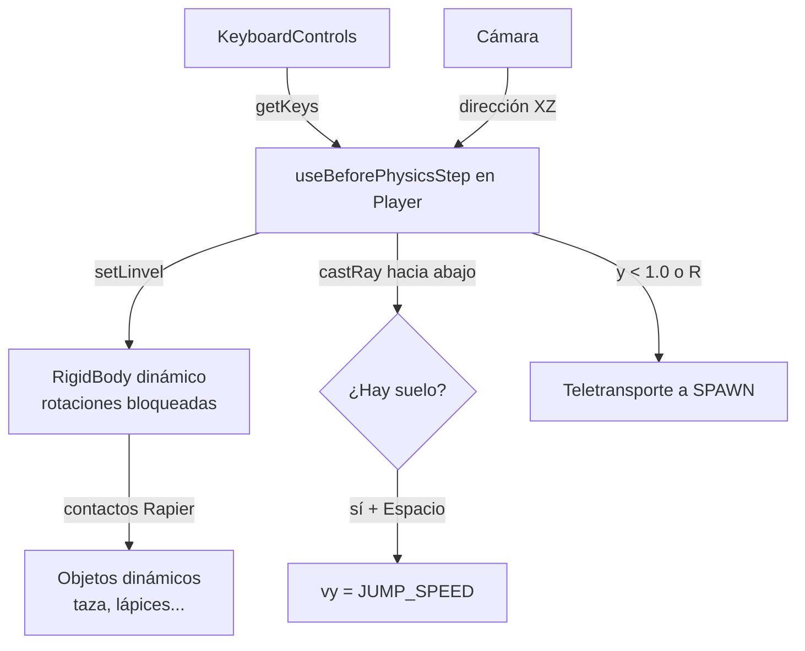

# 🐾 Sistema de personaje

> Personaje controlable con el teclado que recorre el escritorio y empuja los objetos. Es un gato animado (`public/3d-models/gato.glb`).

## Archivos

| Archivo | Rol |
|---|---|
| `src/components/player/keyboardMap.ts` | Acciones (`Controls`), mapa de teclas para `<KeyboardControls>` y etiquetas legibles. |
| `src/components/player/Player.tsx` | Cuerpo físico + control en cada paso de física (`useBeforePhysicsStep`); giro visual y animaciones en `useFrame`. |
| `src/components/scene-environment/ControlsHelp.tsx` | Panel HTML con las instrucciones (se pliega con **H**). |
| `src/App.tsx` | Envuelve el `<Canvas>` con `<KeyboardControls>` y monta `<Player />` dentro de `<Physics>`. |

## Controles

| Acción | Teclas |
|---|---|
| Moverse | `W A S D` / flechas |
| Correr | `Shift` + mover |
| Saltar | `Espacio` |
| Volver al escritorio | `R` |
| Mostrar / ocultar ayuda | `H` |

Para cambiar una tecla basta con editar `keyboardMap`; el panel de ayuda se actualiza solo. Si añades un código de tecla nuevo, añade también su etiqueta en `keyLabels`.

## Cómo funciona

- **Movimiento relativo a la cámara**: "adelante" es la dirección de la cámara proyectada en el plano XZ, así que `W` siempre aleja al personaje del visitante aunque haya girado la vista.
- **Velocidad, no fuerzas**: en **cada paso de física** se interpola la velocidad horizontal hacia la deseada y se conserva la vertical. Hacerlo por paso, y no por fotograma, es lo que hace que el empuje no dependa de los FPS: con pocos FPS hay varios pasos por fotograma y el contacto frenaría al personaje entre medias.
- **Volcar objetos**: el `userData` del cuerpo (`PlayerUserData`) publica `kind: 'player'` y la velocidad que intenta llevar. Los objetos con `knock` lo usan para volcarse al recibir el golpe (ver [Sistema de físicas](./sistema-de-fisicas.md#volcar-objetos-con-el-personaje-knock)).
- **Rotación bloqueada** (`enabledRotations={[false, false, false]}`): el cuerpo físico no gira. El giro hacia la dirección de avance se aplica solo al `<group>` visual; por eso el collider es una cápsula vertical, simétrica respecto a Y.
- **Salto**: solo al pulsar (no manteniendo) y si un rayo corto hacia abajo detecta suelo.
- **Caídas**: los objetos pueden caer al suelo, pero si el personaje baja de `y = 1.0` vuelve automáticamente a `SPAWN`.

## Constantes ajustables (`Player.tsx`)

| Constante | Valor | Efecto |
|---|---|---|
| `RADIUS` / `HALF_HEIGHT` | `0.08` / `0.02` | Radio y media altura del tramo recto de la cápsula. `FEET_OFFSET` (su suma) es la distancia del centro a los pies: alcance del rayo de suelo y desplazamiento del modelo. |
| `CAT_SCALE` | `0.5` | Escala del modelo (el .glb mide ~0,58 de largo). |
| `SIT_AFTER` / `SLEEP_AFTER` | `8` / `20` | Segundos quieto hasta sentarse / dormirse. |
| `FADE` | `0.2` | Duración del fundido entre animaciones. |
| `JUMP_TAKEOFF` / `JUMP_LANDING` | `0.42` / `1.0` | Despegue y aterrizaje dentro del clip `Jump` (s). Si cambias `JUMP_SPEED` o el clip, revisa estos valores. |
| `SPAWN` | `(-0.7, 1.7, 0.6)` | Punto de aparición (cae sobre el escritorio, en y ≈ 1.48). |
| `FALL_LIMIT_Y` | `1.0` | Altura por debajo de la cual se reaparece. |
| `WALK_SPEED` / `RUN_SPEED` | `1.2` / `2.2` | Velocidad en unidades por segundo. |
| `ACCELERATION` | `12` | Rapidez para alcanzar y perder la velocidad. |
| `JUMP_SPEED` | `2.6` | Velocidad vertical al saltar (~0.35 u de altura). |
| `TURN_SPEED` | `12` | Rapidez del giro visual. |
| `density` (collider) | `3` | Masa: más alta = empuja objetos más pesados. |

## Modelo y animaciones

El modelo se carga con `useGLTF` y se anima con `useAnimations` de drei. Mira hacia **+Z** y tiene los pies en `y = 0`, así que se baja `FEET_OFFSET` para apoyarlo en la base de la cápsula.

| Estado | Animación |
|---|---|
| Al saltar | `Jump` (una vez; tiene prioridad sobre las demás hasta que termina) |
| Moviéndose | `Walk` (con `timeScale = RUN_SPEED / WALK_SPEED` al correr) |
| Quieto | `Idle` |
| Quieto más de `SIT_AFTER` s | `Sit` |
| Quieto más de `SLEEP_AFTER` s | `Sleep` |

### Sincronizar `Jump` con la física

El clip dura 1,5 s: preparación (0–0,42 s), vuelo (0,42–1,0 s) y recuperación (1,0–1,5 s). El salto físico es inmediato y dura `2·JUMP_SPEED / g` ≈ 0,53 s en el aire, así que:

- El clip **empieza en `JUMP_TAKEOFF`** (se salta la preparación).
- Se **acelera** con `JUMP_TIME_SCALE` para que el vuelo del clip coincida con el de la simulación.
- El clip sube el hueso `torso` (~0,24 u del modelo), pero la altura ya la da la física: en cada fotograma se **resta esa subida** al modelo, ponderada por el peso del clip. La bajada al aterrizar no se compensa, porque el gato se agacha con las patas apoyadas.
- Se reproduce una vez (`LoopOnce`) y se queda en su última pose (`clampWhenFinished`) para fundirse desde ahí con la siguiente animación.

El .glb trae también `LickPaw`, `Meow`, `PawTouch` y `Sniff`, sin usar por ahora. Todas son cíclicas. Para usar otra, añade su nombre a `CatAnimation` y decide en el `useFrame` cuándo elegirla: el cambio con fundido ya está resuelto.
