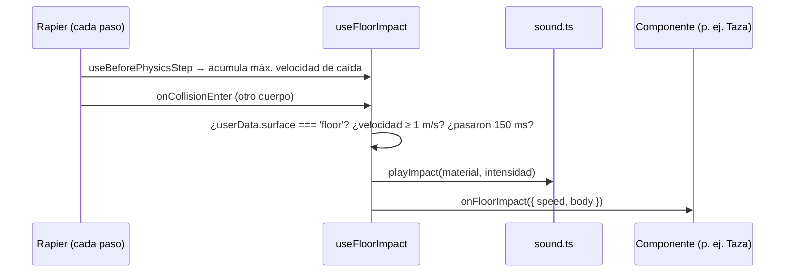

# 🔊 Sistema de sonido

> Los objetos suenan al golpear el suelo, según su material. Todo el audio se **sintetiza** con Web Audio: no hay archivos que descargar.

## Archivos

| Archivo | Rol |
|---|---|
| `src/audio/sound.ts` | Motor: `AudioContext`, recetas por material, `playImpact`, `playShatter`, silencio. |
| `src/hooks/useFloorImpact.ts` | Detecta golpes contra el suelo y dispara el sonido + callback. |
| `src/components/physics/RigidObject.tsx` | Props `sound` y `onFloorImpact`. |
| `src/components/environment/Floor.tsx` | Marca el suelo con `userData={{ surface: 'floor' }}`. |
| `src/main.tsx` | `installAudioUnlock()`: reanuda el audio en el primer gesto del usuario. |

## Flujo



- **Velocidad de impacto**: antes de cada paso de física se guarda la **máxima velocidad de caída desde la última colisión**. Leerla en `onCollisionEnter` no sirve: Rapier ya resolvió el choque y, con FPS bajos, se ejecutan varios pasos antes de entregar los eventos.
- **`userData`**: en `@react-three/rapier` v2 el `userData` de `<RigidBody>` se guarda en el cuerpo de Rapier (`payload.other.rigidBody.userData`), no en el `Object3D`.
- **Intensidad**: `(velocidad − 1) / 6`, limitada a 0–1. Una caída desde el escritorio (~6 m/s) suena casi a volumen máximo.
- **Rebotes**: enfriamiento de 150 ms por objeto para no encadenar sonidos.

## Materiales

| Material | Receta | Objetos |
|---|---|---|
| `ceramic` | 3 parciales agudos inarmónicos (~2,4 kHz) + clic de ruido | Taza |
| `plastic` | Ruido pasabanda ~1,2 kHz + golpe grave corto | Teclado, ratón, reloj, pulsera, auriculares, coche, logos |
| `metal` | Parciales inarmónicos con caída larga (~0,45 s) | Lámpara, portalápices, mano robótica |
| `wood` | Ruido pasabajos + tono ~320 Hz | Lápices |

Cada sonido varía el tono ±10 % al azar para que no suene repetitivo. `playShatter()` (taza rota) combina una ráfaga de ruido agudo con 6–10 tintineos repartidos en 250 ms.

## Silencio

La tecla **M** (o la fila "Sonido" del panel de ayuda) alterna el silencio. El estado se guarda en `localStorage` (`sound-muted`).

## Añadir sonido a un objeto nuevo

```tsx
<RigidObject type="dynamic" sound="plastic" position={[...]}>
  ...
</RigidObject>
```

Para un material nuevo: añadirlo al tipo `SoundMaterial` y una receta en `recipes` (`src/audio/sound.ts`).

## Pasar a archivos de audio

La API (`playImpact(material, intensidad)`, `playShatter()`) no depende de cómo se genera el sonido. Para usar archivos:

1. Colocar los `.ogg` / `.mp3` en `public/sounds/`.
2. En `sound.ts`, cargarlos con `fetch` + `ctx.decodeAudioData` al desbloquear el audio.
3. Sustituir las recetas por un `AudioBufferSourceNode` con `playbackRate` variable (±10 %) y una ganancia según la intensidad.

## Documentos relacionados

- [Sistema de físicas](./sistema-de-fisicas.md) (objetos rompibles)
- [Sistema de personaje](./sistema-de-personaje.md)
