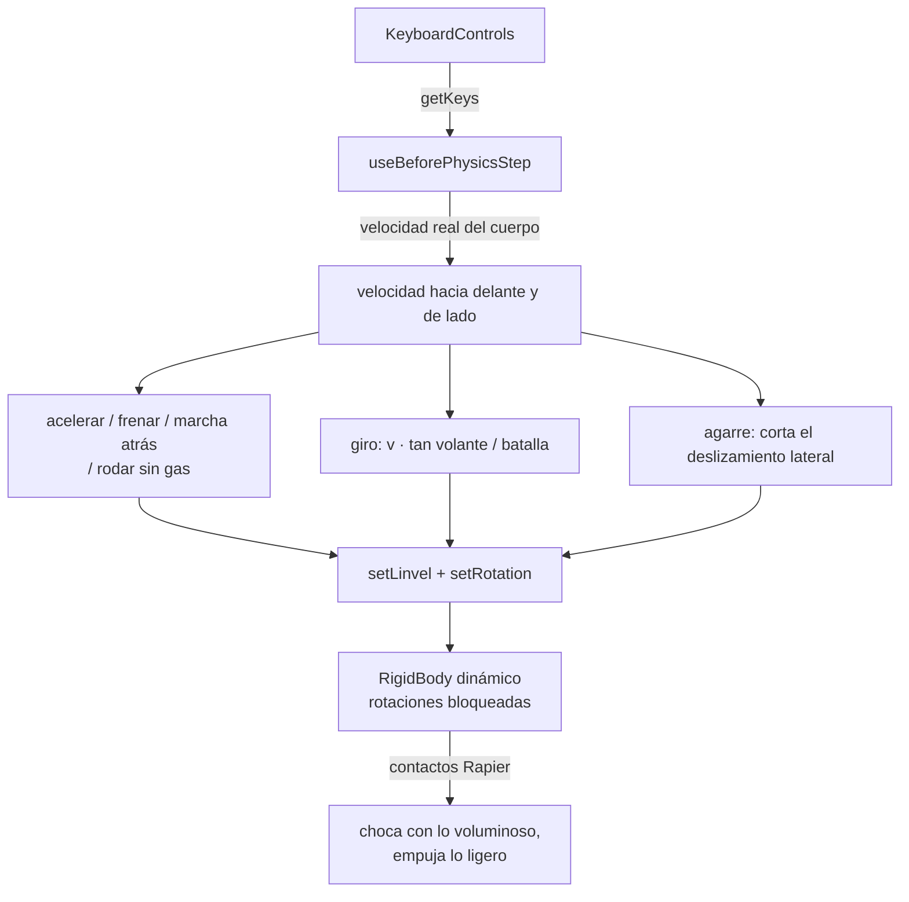

# 🚗 Sistema de vehículo

> Inicio > 04 — Escena 3D > Sistema de vehículo

El personaje controlable es un coche (`public/3d-models/vehicle.glb`) que se conduce por el escritorio con el teclado. Acelera, frena, da marcha atrás, gira, tiene turbo y freno de mano. Pasa por encima de la alfombrilla y del portavasos, choca con los objetos voluminosos y empuja los ligeros.

## Archivos

| Archivo | Rol |
|---|---|
| `src/components/player/DrivableVehicle.tsx` | Cuerpo físico, conducción en cada paso de física (`useBeforePhysicsStep`), ruedas y luces en `useFrame`. |
| `src/components/player/keyboardMap.ts` | Teclas (las mismas acciones que el gato, con otro significado). |
| `src/components/physics/density.ts` | `BULKY_DENSITY`: densidad de los objetos que el coche no puede empujar. |
| `src/components/scene-environment/ControlsHelp.tsx` | Panel de instrucciones (se pliega con **H**). |
| `src/App.tsx` | Monta `<DrivableVehicle />` dentro de `<Physics>`. |

El gato (`Player.tsx`, `gato.glb`) sigue en el repo, pero no se monta. Ver [Sistema de personaje](./sistema-de-personaje.md).

## Controles

Relativos al coche, no a la cámara.

| Acción | Teclas | Acción del mapa |
|---|---|---|
| Acelerar | `W` / `↑` | `forward` |
| Frenar; ya parado, marcha atrás | `S` / `↓` | `back` |
| Girar | `A D` / `← →` | `left` / `right` |
| Turbo | `Shift` + acelerar | `run` |
| Freno de mano (frena y derrapa) | `Espacio` | `jump` |
| Volver a su sitio | `R` | `reset` |

## Cómo funciona

- **Modelo bicicleta**: la velocidad hacia delante cambia con el acelerador o el freno. El giro (yaw) es `velocidad · tan(volante) / batalla`. El deslizamiento lateral se amortigua con `GRIP`, y con el freno de mano con `HANDBRAKE_GRIP`, que es menor y deja derrapar.
- **Por velocidad, en cada paso de física**, como el gato. La velocidad se lee del cuerpo en cada paso: si un choque lo frena, el coche no acumula una velocidad que no lleva.
- **Rotaciones bloqueadas**: el coche no vuelca. El giro en Y se fija a mano con `setRotation`.
- **Sin tracción en el aire**: si ninguna rueda toca suelo (un rayo corto bajo cada una), ni acelera ni gira.
- **Caídas**: por debajo de `y = 1.0`, o con `R`, vuelve a su pose inicial.
- **Volcar objetos**: publica `kind: 'player'` y su velocidad en el `userData` (`PlayerUserData`), así que los objetos con `knock` (el portalápices) siguen funcionando.

> Se probó primero el vehículo de rayos de Rapier (`DynamicRayCastVehicleController`). A esta escala (unos 40–47 cm, ~0,1 kg) las ruedas o resbalaban de lado sin girar, o con más agarre el coche se inclinaba y giraba al revés. El modelo bicicleta es predecible y fácil de ajustar.

### Forma física

| Pieza | Forma | Para qué |
|---|---|---|
| Ruedas | 4 esferas del radio de la rueda (3 cm) en los centros de `wheel_*` | Tocan la mesa. Suben los bordes de 4 mm (alfombrilla, portavasos) y chocan con lo que llega por encima del eje (la placa del teclado, a 5,8 cm; la base del monitor, a 3,4 cm). |
| Carrocería | Caja ajustada a la malla, de 2,5 a 11,5 cm de altura | Choca con todo lo demás. |

Todas sin fricción (regla `Min`): el coche se mueve por velocidad y así no arrastra lo que pisa.

### Qué lo detiene y qué empuja

Los objetos voluminosos llevan `density={BULKY_DENSITY}` (100). Así pesan decenas de veces más que el coche, que tiene masa ~0,1 (`CHASSIS_DENSITY`).

| Objeto | Comportamiento (medido) |
|---|---|
| Alfombrilla, portavasos | Pasa por encima (sube ~7 mm). |
| Teclado, lámpara, mano robótica, auriculares | Lo detienen; se mueven < 1 mm. |
| Monitor (base y cuello) | Lo detiene. La pantalla empieza a 27 cm de la mesa: el coche (11,5 cm) cabe debajo, por los lados de la base. |
| Taza, ratón, reloj, logos, lápices | Los empuja (taza ~16 cm y ratón ~25 cm en un segundo de empuje). |

## Modelo

El `.glb` original era una sola malla. Para que las ruedas giren, las 4 islas de las ruedas se separaron en objetos propios, con el origen en su eje:

| Nodo | Posición (escala 1) |
|---|---|
| `body` | resto de la carrocería |
| `wheel_front_left` / `wheel_front_right` | `(±0,557, 0,239, 0,936)` |
| `wheel_rear_left` / `wheel_rear_right` | `(±0,557, 0,239, −0,880)` |

El coche mira a **+Z** (faros en +Z, pilotos `redLightMaterial` en −Z). En `useFrame`:
- Las ruedas giran sobre su eje según la velocidad, y las delanteras también con el volante (orden de Euler `YXZ`: primero el volante, luego el giro).
- Los pilotos traseros se encienden al frenar, al dar marcha atrás o con el freno de mano (material propio con `emissive`).
- La carrocería cabecea un poco: morro abajo al frenar y arriba al acelerar.

### Flujo de archivos del modelo

1. Fuente editable: `~/Documents/modelos/vehicle.blend`. Blender deja la versión anterior como `vehicle.blend1`.
2. Exportación glTF (GLB, sin animaciones): `~/Documents/ok/models/vehicle.glb`.
3. Copia en el proyecto: `public/3d-models/vehicle.glb`.

## Constantes ajustables (`DrivableVehicle.tsx`)

| Constante | Valor | Efecto |
|---|---|---|
| `S` | `0.1275` | Escala del modelo (40 × 17 × 11,5 cm). Todas las medidas físicas salen de ella. |
| `SPAWN_POSITION` / `SPAWN_YAW` | `(-2, 1.5, 0.2)` / `1` | Pose inicial (la del antiguo coche decorativo). |
| `ACCELERATION` / `REVERSE_ACCELERATION` | `2` / `1.2` m/s² | Motor hacia delante y marcha atrás. |
| `BRAKE_DECELERATION` / `HANDBRAKE_DECELERATION` / `ROLLING_DECELERATION` | `5` / `3` / `0.6` m/s² | Freno, freno de mano y rodar sin gas. |
| `MAX_SPEED` / `TURBO_SPEED` / `MAX_REVERSE_SPEED` | `1.2` / `2` / `0.5` m/s | Velocidades máximas. |
| `MAX_STEER` / `STEER_SPEED_FALLOFF` | `0.5` rad / `0.6` | Ángulo de volante parado, y cuánto se reduce con la velocidad. |
| `GRIP` / `HANDBRAKE_GRIP` | `14` / `2` | Agarre lateral (1/s), normal y con freno de mano. |
| `CHASSIS_DENSITY` | `16` | Masa del coche (~0,1): más alta = empuja objetos más pesados. La masa varía con el cubo de `S`: si cambias la escala, compénsala aquí. |

Medido a 60 Hz, con `S = 0.1275`: de 0 a 1,2 m/s en 0,6 s; frena de 1,2 m/s a 0 en 0,48 s (8 cm); gira ~1,1 rad en 1,5 s a fondo.

## Documentos relacionados

- [Sistema de físicas](./sistema-de-fisicas.md)
- [Sistema de personaje](./sistema-de-personaje.md)
- [Posicionamiento de objetos](./posicionamiento-de-objetos.md)
