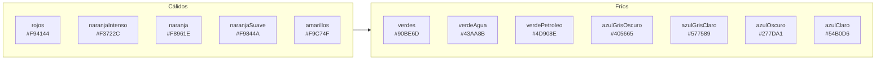

# Sistema de colores

> Inicio > 05 — Estilos > Sistema de colores

El proyecto define su propia paleta de colores en `src/helpers/paleta-colores.ts`. Este documento explica cómo usarla.

## ¿Qué es?

Es un **sistema tipado de paletas**, no una constante única. Define:

- **12 gamas de colores** (rojos, naranjas, amarillos, verdes, azules, etc.).
- **5 intensidades** por gama (de 500 = más saturado/oscuro, a 100 = más claro).

Los valores siguen una escala tipo Material Design / Tailwind pero son **valores personalizados del proyecto**.

## Estructura del helper

```ts
// src/helpers/paleta-colores.ts

export type EscalaTonos = {
  100: string;
  200: string;
  300: string;
  400: string;
  500: string;
};

export const rojos: EscalaTonos = {
  500: '#F94144',
  400: '#FA5457',
  300: '#FA6769',
  200: '#FB7A7C',
  100: '#FB8D8F',
};

// … 11 gamas más …

export const paletaColores = {
  rojos,
  naranjaIntenso,
  naranja,
  naranjaSuave,
  amarillos,
  verdes,
  verdeAgua,
  verdePetroleo,
  azulGrisOscuro,
  azulGrisClaro,
  azulOscuro,
  azulClaro,
} as const;

export type NombrePaleta = keyof typeof paletaColores;
export type IntensidadColor = 100 | 200 | 300 | 400 | 500;
```

## Las 12 gamas

| Gama | 500 (oscuro) | Uso típico |
|---|---|---|
| `rojos` | `#F94144` | Acentos cálidos. |
| `naranjaIntenso` | `#F3722C` | Llamativos, energía. |
| `naranja` | `#F8961E` | Cálido estándar. |
| `naranjaSuave` | `#F9844A` | Cálido sutil. |
| `amarillos` | `#F9C74F` | Alegres, lápiz amarillo. |
| `verdes` | `#90BE6D` | Naturales, suaves. |
| `verdeAgua` | `#43AA8B` | Turquesa apagado. |
| `verdePetroleo` | `#4D908E` | Teal grisáceo. |
| `azulGrisOscuro` | `#405665` | Oscuros, "oficina". |
| `azulGrisClaro` | `#577589` | Neutros. |
| `azulOscuro` | `#277DA1` | Azul profesional. |
| `azulClaro` | `#54B0D6` | Claros, cielo. |

## Colores de la interfaz HTML

Los overlays (pantalla de carga y panel de controles) no usan la paleta directamente, sino `coloresUI` de `src/helpers/colores-ui.ts`, que elige los tonos una sola vez para que ambos encajen con la escena:

| Clave | Tono | Uso |
|---|---|---|
| `background` | `azulGrisOscuro[100]` | Fondo de la pantalla de carga y del panel |
| `surface` | `azulGrisOscuro[300]` | Teclas, barra, cajas internas |
| `border` | `azulGrisClaro[400]` | Bordes |
| `accent` | `amarillos[500]` | Logo, relleno de barra, letras de teclas, títulos de sección |
| `muted` | `azulGrisClaro[100]` | Texto secundario |
| `ok` / `danger` | `verdes[500]` / `rojos[500]` | Estado del sonido (activado / silenciado) |

## Diagrama visual de las gamas



## Cómo usarla

### Importar una gama individual

```ts
import { rojos, amarillos } from './helpers/paleta-colores';

const miColor = rojos[500];        // '#F94144'
const miColor2 = amarillos[300];   // '#FAD375'
```

### Importar la paleta completa

```ts
import { paletaColores, type NombrePaleta, type IntensidadColor } from './helpers/paleta-colores';

const gama: NombrePaleta = 'rojos';
const intensidad: IntensidadColor = 500;
const color = paletaColores[gama][intensidad]; // '#F94144'
```

### Uso típico en un componente 3D

```tsx
import { MeshStandardMaterial } from 'three';
import { paletaColores } from './../../helpers/paleta-colores';

const customMaterial = new MeshStandardMaterial({
  color: paletaColores['rojos'][500]
});
```

Éste es el patrón usado en `Lapiz.tsx`.

## Tipos exportados

### `NombrePaleta`

Es la unión de las claves de `paletaColores`. Garantiza que sólo puedes pasar strings válidos:

```ts
const p: NombrePaleta = 'rojos';   // ✅
const p2: NombrePaleta = 'rosa';   // ❌ error TS
```

### `IntensidadColor`

Es una unión literal: `100 | 200 | 300 | 400 | 500`. Evita que pases `700` o `50`:

```ts
const i: IntensidadColor = 500;   // ✅
const i2: IntensidadColor = 700;  // ❌ error TS
```

## Cómo añadir una gama nueva

```ts
// 1. Define la escala
export const fucsia: EscalaTonos = {
  500: '#E63946',
  400: '#EB4956',
  300: '#F05A66',
  200: '#F56B76',
  100: '#FA7C85',
};

// 2. Añádela al objeto paletaColores
export const paletaColores = {
  rojos,
  // …,
  fucsia,        // ← añadir aquí
} as const;
```

Como `NombrePaleta = keyof typeof paletaColores`, el tipo se actualiza automáticamente.

## Cómo añadir una intensidad nueva

Por ejemplo, añadir `600`:

```ts
export type EscalaTonos = {
  100: string;
  200: string;
  300: string;
  400: string;
  500: string;
  600: string;          // ← nueva
};

export const rojos: EscalaTonos = {
  500: '#F94144',
  // …
  600: '#E92B2E',       // ← añadir en cada gama
};
```

Y actualizar el tipo `IntensidadColor`:

```ts
export type IntensidadColor = 100 | 200 | 300 | 400 | 500 | 600;
```

> ⚠️ TypeScript comprobará automáticamente que cada gama tiene la intensidad `600`.

## Uso fuera de three.js

El helper **no está acoplado a three.js**. Es un módulo TypeScript puro que puedes usar en cualquier parte:

```tsx
import { rojos } from './helpers/paleta-colores';

<div style={{ background: rojos[300], padding: '1rem' }}>
  Hola
</div>
```

## Documentos relacionados

- [Visión general](../01-arquitectura/vision-general.md)
- [Cómo crear un componente reutilizable](../03-componentes/como-crear-componente-reutilizable.md)
- [Guía de diseño de componentes](../03-componentes/guia-de-diseno-completo.md)