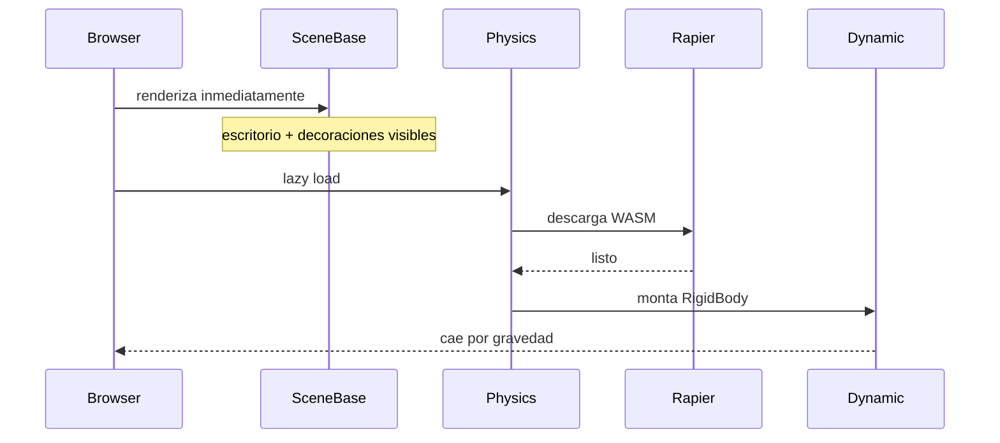

# Rendimiento

> Inicio > 06 — Rendimiento

Estrategia de optimización aplicada al proyecto y cómo iterar.

## Estado actual

El proyecto aplica una serie de optimizaciones que reducen drásticamente el coste del primer render.

### Tamaños del bundle (build de producción)

| Chunk | Tamaño | Gzip | ¿Cuándo se carga? |
|---|---|---|---|
| `index` (código del proyecto) | ~194 kB | **60 kB** | Inmediato |
| `r3f` (three.js + fiber + drei) | ~995 kB | **266 kB** | Inmediato |
| `rapier` (motor de físicas) | ~2.3 MB | **851 kB** | Bajo demanda |

**Total cargado en el primer paint**: ~326 kB gzip (era ~1.17 MB gzip antes).

El chunk de Rapier (el más pesado) **no se descarga hasta que el visitante abre la página y se monta `<Physics>`**, gracias a `React.lazy`.

## Optimizaciones aplicadas

### 1. Code-splitting manual en Vite

`vite.config.ts` separa el bundle en tres chunks:

```ts
manualChunks(id: string): string | undefined {
  if (id.includes('node_modules/three/')) return 'three';
  if (
    id.includes('node_modules/@react-three/fiber') ||
    id.includes('node_modules/@react-three/drei')
  ) {
    return 'r3f';
  }
  if (id.includes('node_modules/@react-three/rapier')) {
    return 'rapier';
  }
  return undefined;
}
```

### 2. Lazy-load de Rapier

El componente `<Physics>` de `@react-three/rapier` se importa directamente en `App.tsx` con `React.lazy`:

```tsx
const Physics = lazy(async () => {
  const mod = await import('@react-three/rapier');
  return { default: mod.Physics };
});
```

**Todos los componentes físicos** (fijos + dinámicos) se importan también con `React.lazy`, así el chunk de cada uno sólo se descarga cuando se monta `<Physics>`.

Mientras el chunk llega, `<Suspense fallback={null}>` no renderiza nada. Cuando está listo, los RigidBody aparecen y caen con gravedad.

### 3. Escena en dos fases

`App.tsx` divide la escena en dos componentes:

- **`<SceneBase />`**: escritorio, monitor, mausePad, portaVasos, suelo, paredes, alfombra, planta, cuadro. **Se renderiza inmediatamente**, sin esperar a Rapier. El visitante ve el escritorio en cuanto el primer chunk llega.

- **`<PhysicsScene />`**: taza, lápices, reloj, lámpara, etc. Se monta dentro de `<Physics>`. Aparecen suspendidos en el aire durante unos ms; cuando Rapier carga, caen.



### 4. `<Preload />` selectivo

`<SceneBase />` usa `<Preload />` (sin la prop `all`) para precargar **sólo los `.glb` que ya están renderizados** (los fijos). Los `.glb` de los modelos dinámicos se preloadingarán cuando se active la fase 2.

### 5. Shadow map reducido

`Light.tsx` usa `shadow-mapSize={1024, 1024}` en lugar de 2048×2048. Esto reduce el consumo de GPU y memoria a la cuarta parte, con impacto visual mínimo en escenas pequeñas como esta.

### 6. Overlay de diagnóstico

`StatsOverlay.tsx` muestra los **FPS actuales** en la esquina superior derecha, sólo en desarrollo (`import.meta.env.DEV`).

## Cómo iterar

### Medir antes/después

1. Abre la app en el navegador con `npm run dev`.
2. Mira el overlay FPS en la esquina superior derecha.
3. Usa las DevTools del navegador (`Performance` tab) para flamegraphs.

### Si los FPS son bajos

| Síntoma | Solución |
|---|---|
| FPS < 30 al cargar | Probablemente el lazy-load de Rapier aún no terminó. Es normal los primeros segundos. |
| FPS bajo al arrastrar personas | Demasiados draw calls. Revisar si hay muchos meshes en un mismo RigidObject. Combinar mallas o usar `InstancedMesh` cuando aplique. |
| FPS bajo al rotar la cámara | El shadow map se recalcula. Reducir a 512×512 o desactivar temporalmente. |
| Memoria del navegador crece | Probablemente no se liberan los `.glb`. Revisar que cada componente llame a `useGLTF.preload` correctamente. |

### Si el bundle es grande

```bash
npm run build
```

Revisa los tamaños en la tabla que imprime Vite. Si algún chunk > 1MB, considera:

- ¿Hay modelos muy pesados en `public/3d-models/`?
- ¿Se puede comprimir más con Draco en Blender?
- ¿Se puede usar `InstancedMesh` para meshes repetidos?

## Limitaciones conocidas

- ❌ **El chunk de Rapier es grande (2.3 MB)**: es el WASM compilado. Reducirlo más requeriría sustituir Rapier por otro motor o usar un subset.
- ❌ **No hay LOD (Level of Detail)**: todos los meshes se renderizan con la misma calidad independientemente de la distancia a la cámara.
- ❌ **No hay frustum culling personalizado**: three.js hace culling por defecto pero no es perfecto.

## Documentos relacionados

- [Sistema de escena](./04-escena-3d/sistema-de-escena.md)
- [Loading y Suspense](./04-escena-3d/loading-y-suspense.md)
- [Sistema de físicas](./04-escena-3d/sistema-de-fisicas.md)